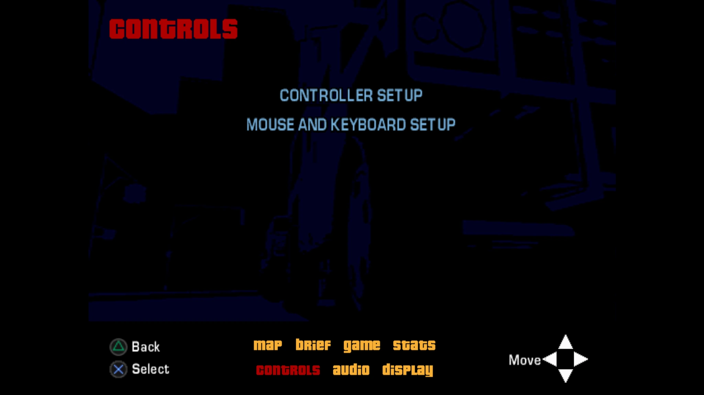
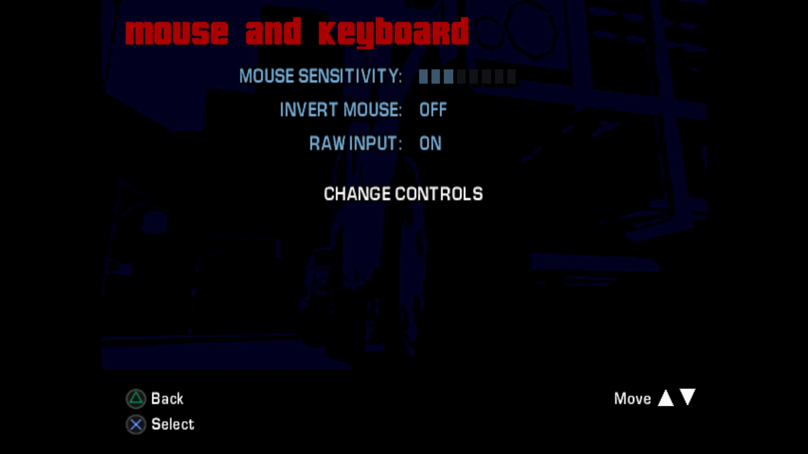
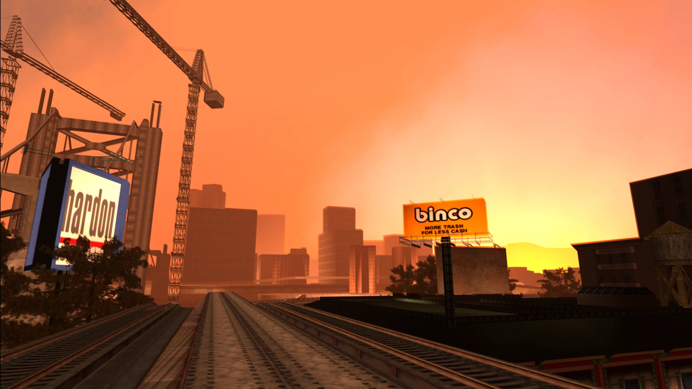

<h1 align="center">LCS Recomp</h1>

<p align="center">
  
</p>

<h3 align="center">Liberty City Stories. Recompiled for PC.</h3>

<p align="center">
  An unofficial native PC recompilation of the PlayStation 2 version of Grand Theft Auto: Liberty City Stories.
</p>

<p align="center">
  
  
  
  
  
  
</p>

<p align="center">
  <a href="https://github.com/NicoWayne95/lcs-ps2-recomp/releases"><strong>Download</strong></a> ·
  <a href="https://github.com/NicoWayne95/lcs-ps2-recomp/releases/tag/v0.2.0-beta">Release Notes</a> ·
  <a href="#upcoming-update">Upcoming Update</a> ·
  <a href="#source-code--open-source-development">Source Code</a> ·
  <a href="https://github.com/NicoWayne95/lcs-ps2-recomp/discussions">Discussions</a> ·
  <a href="https://github.com/NicoWayne95/lcs-ps2-recomp/issues">Report a Bug</a>
</p>

---

## Welcome back to Liberty City!

**LCS Recomp** is an independent fan project bringing the PlayStation 2 version of Grand Theft Auto: Liberty City Stories to PC through static recompilation and a custom runtime.

The project aims to preserve the original game's atmosphere, gameplay and visual identity while introducing optional improvements for modern hardware.

Rather than replacing the original experience, the goal is to give players the freedom to choose between an authentic PlayStation 2 experience and an enhanced PC experience.

LCS Recomp is developed as a personal hobby project in my free time. It is my first recompilation project of this kind, and development is an ongoing learning process.

The game is prepared and recompiled locally using your own original game ISO. No original game files are included.

> [!IMPORTANT]
> LCS Recomp is currently in Public Beta.
> 
> Bugs, crashes, incomplete features and compatibility issues are to be expected. Development is ongoing, and nothing should currently be considered final.

---

## Download & Project Status

| | Status |
| :--- | :--- |
| Current Public Release | **v0.2.0 — Public Beta** |
| Upcoming Release | **v0.2.1 — Quality of Life Update** |
| Platform | Windows 10 / 11 (64-bit) |
| Renderer | DirectX 11 |
| Distribution | Portable |
| Development | Active |
| Source Code | Public repository restructuring in progress |

<p align="center">
  <a href="https://github.com/NicoWayne95/lcs-ps2-recomp/releases">
    
  </a>
</p>

> [!TIP]
> For the most consistent gameplay experience with the current public beta, I recommend playing at **60 FPS with a controller using the Classic control scheme.**

---

## Upcoming Update

### v0.2.1 — Quality of Life Update

The next update focuses on improving the overall gameplay experience, controller compatibility, camera behavior, HUD positioning, high-frame-rate gameplay and hardware compatibility.

The intention is to address as many of the issues reported following the first public beta as possible while continuing to improve the game's technical foundation.

### Controls & Controller Support

- Corrected mouse inversion behavior.
- Xbox controller support through XInput.
- PlayStation controller integration through HIDAPI.
- Improved Xbox analog-stick sensitivity while aiming.
- Free mouse-controlled exterior vehicle camera.
- Vehicle camera movement without holding the right mouse button.
- Smooth automatic camera recentering.
- Improved vehicle camera collision handling.
- Separate vertical camera limits for vehicles and third-person free aim.

### Adaptive Input Prompts

Dynamic input prompts are currently being implemented.

The game is being extended to automatically display the appropriate button icons depending on the most recently used input device.

Supported input styles under development:

- Keyboard & Mouse.
- Xbox controllers.
- PlayStation controllers.

The new system is designed to support gameplay instructions, action prompts and pause-menu button indicators.

The first rendering hooks and shared texture atlas have been implemented. Visual validation and automatic device switching are currently being tested.

Input prompt assets are provided by [Kenney](https://kenney.nl/assets/input-prompts) under the CC0 license.

### Vehicle Physics & HUD

- Corrected passive vehicle rolling resistance above 30 FPS.
- Cars now coast more naturally at higher frame rates.
- The same timestep-based rolling resistance correction has been applied to motorcycles.
- Fixed excessive movement of parked vehicles when the player runs into them above 30 FPS.
- Improved wanted star blinking using real-time timing.
- Corrected radar map, ring and marker alignment in the Screen Edges HUD layout.
- Improved positioning of the upper-right HUD status display.

### Environmental Effects & High FPS

Additional frame rate-dependent behavior is currently being investigated and corrected.

- Exhaust smoke timing.
- Tire smoke lifetime and transparency.
- Animated billboards and scrolling signs.
- Cloud movement and rotation.
- Water surface animation.
- General high-FPS animation and particle behavior.

Several corrections have already been implemented in development builds, while others still require visual verification or further investigation.

### Hardware Compatibility

The Windows development build now targets AVX1 rather than AVX2 as its standard CPU instruction set.

This is intended to improve compatibility with older processors that do not support AVX2.

Practical testing on older AVX-capable hardware and validation of launcher-generated release builds are still pending.

### Performance

Ongoing optimization work includes:

- Reduced CPU-side rendering overhead.
- More efficient processing of world and model rendering commands.
- Investigation of unnecessary memory copying.
- Improved host presentation and frame pacing.
- Improved frame-time consistency.
- Better performance on older and lower-end systems.

Performance candidates remain experimental until gameplay and comparative benchmarks have been completed.

> [!NOTE]
> These changes describe the current development status of v0.2.1.
>
> Not all features are available in the current public beta, and some changes may be adjusted, removed or postponed before the next release.

---

## Launcher & Portable Distribution

The original launcher was developed within a relatively short period of time to provide a functional way to prepare and launch the first public beta.

While it served its initial purpose, there are several areas that require improvements in terms of design, usability, maintainability and reliability.

The launcher is now being reworked as a dedicated component of the project.

### Portable-First Approach

LCS Recomp is moving towards a portable-first distribution model.

Instead of relying on a traditional Windows installer, the intended workflow is to download the portable archive, extract it to a directory of your choice and launch the application directly.

The objectives are:

- Simple distribution through a portable ZIP archive.
- No traditional installation process for the application itself.
- Flexible installation location.
- Organized local directory structure.
- Local configuration and savegame management.
- Clear separation between the launcher, game runtime and preparation tools.
- Easier backup, maintenance and removal of project files.
- A more transparent game preparation process.

External runtime dependencies may still be required depending on the system.

### Launcher Features

- Original game ISO validation.
- Automated download of required development tools and dependencies.
- Automated local game recompilation.
- Game configuration and launching.
- Savegame management and backups.
- Customizable game and savegame locations.

### Launcher Improvements

The following areas are being revised or are planned for future improvements:

- Redesigned user interface.
- Improved visual presentation and animations.
- Improved preparation and download progress indicators.
- Better error handling and diagnostics.
- More reliable dependency management.
- Integrated update functionality.
- Savegame and configuration preservation during updates.
- Previous-version restoration and rollback.

The update and rollback infrastructure requires further end-to-end validation before it can be considered reliable.

The launcher is still a work in progress. Its design, functionality and distribution structure may change throughout development.

---

## Source Code & Open-Source Development

LCS Recomp is intended to become a publicly maintained open-source project.

I understand the community's interest in accessing the source code, reviewing the implementation, building the project independently and contributing improvements.

The original development environment grew considerably within a short period of time. Since this is my first project of this scale and type, the initial structure was primarily focused on getting the game running rather than establishing a clean public development repository.

The project is therefore undergoing a major restructuring.

### What Is Currently Being Reworked?

- Separation of the game runtime and launcher.
- Organization of source code and third-party dependencies.
- Consistent and reproducible build processes.
- Dedicated development, testing and release workflows.
- Performance profiling and benchmarking infrastructure.
- Build and development documentation.
- Review of third-party licenses and attribution.
- Removal of machine-specific paths, personal information and unrelated local files.
- Separation of copyrighted game data from distributable project source code.

The objective is to provide a repository that other developers can understand, build, maintain and contribute to without relying on my personal development environment.

### New Development Structure

<details>
<summary><b>View the new internal project structure</b></summary>

```text
lcs-ps2-recomp/
├── backups/
├── benchmarks/
├── bin/
│   └── current/
├── build/
├── docs/
│   └── performance/
├── game/
├── launcher/
├── releases/
├── tests/
├── tools/
│
├── .gitattributes
├── .gitignore
├── README.md
│
├── Build-Game.ps1
├── Build-Launcher.ps1
├── Build-Release.ps1
│
├── Start-Game.ps1
├── Start-Launcher.ps1
├── Start-Profiling.ps1
└── Test-Release.ps1
```

| Directory | Purpose |
| :--- | :--- |
| `game/` | Game recompilation and runtime components |
| `launcher/` | Launcher development |
| `tools/` | Build, preparation and development utilities |
| `tests/` | Testing and regression validation |
| `benchmarks/` | Performance measurements |
| `docs/` | Technical documentation |
| `bin/` | Current development builds |
| `build/` | Generated build output |
| `releases/` | Release preparation |
| `backups/` | Local development backups |

This represents the internal development environment, not necessarily the final public repository or the end-user installation.

Local backups, unrelated build artifacts, personal files and copyrighted game assets are not intended to become part of the public repository.

</details>

### Future Open-Source Development

The long-term objective is to enable:

- Publicly accessible project source code.
- Documented build instructions.
- Reproducible game and launcher builds.
- Transparent development through GitHub.
- Community contributions and pull requests.
- Independent testing and technical improvements.
- Better collaboration within the recompilation community.

The complete reorganized development tree is not yet available through this repository.

Preparing the long-term public development repository is separate from providing the corresponding source code required by the licenses of already distributed GPL-covered components. Existing license obligations continue to apply throughout the restructuring.

No copyrighted game ISO or original game assets will be included in the source repository.

No specific publication date for the reorganized repository is being announced at this time.

---

## Current Features

The following overview describes the functionality established during development of the public beta.

Features that are exclusive to the upcoming update are listed separately above.

<table>
<tr>
<td width="50%" valign="top">

### Graphics & Display

- Native DirectX 11 rendering
- Original PS2 rendering resolution
- 1080p, 1440p and 4K
- 16:9 widescreen support
- MSAA up to 8×
- Anisotropic filtering up to 16×
- Original PS2 trails
- Original glow effects
- Fullscreen and windowed modes
- VSync and VRR support

</td>
<td width="50%" valign="top">

### Performance & Gameplay

- 30 FPS
- 60 FPS
- Experimental 120 FPS
- Experimental uncapped FPS
- Improved frame pacing
- Expanded 64 MB game memory
- Playable open world
- Playable missions
- Original cutscenes
- Local savegames

</td>
</tr>
<tr>
<td width="50%" valign="top">

### Controls

- Classic controller configuration
- Pressure-sensitive button support
- Native keyboard and mouse
- Mouse-controlled on-foot camera
- Mouse-wheel weapon switching
- Automatic input device detection
- Mouse navigation in the pause menu
- Configurable mouse settings

</td>
<td width="50%" valign="top">

### PC Features

- Extended graphics settings
- Local configuration files
- Adjustable pedestrian draw distance
- Adjustable world fog distance
- Customizable savegame directory
- Integrated savegame backups
- Free Camera mode
- Toggleable HUD visibility
- Performance diagnostics

</td>
</tr>
</table>

### Audio

The native audio implementation supports:

- Original radio stations.
- Original music and sound effects.
- Ambient audio.
- Dialogue and mission audio.
- Cutscene audio.
- Original introductory movie playback.

Some features remain experimental and require further compatibility and stability testing.

---

## Two Ways to Experience Liberty City

The long-term vision for LCS Recomp is to offer both an authentic console experience and an enhanced native PC experience.

| Classic Experience | Enhanced PC Experience |
| :--- | :--- |
| Original PS2 visual identity | Higher rendering resolutions |
| Original rendering resolution | Up to 4K |
| Classic controller layout | Modern controller configurations |
| Original 30 FPS timing | Higher frame rates |
| Pressure-sensitive buttons | Native keyboard and mouse controls |
| Original visual effects | Additional graphics options |
| Original gameplay behavior | Improved camera controls |
| Original world presentation | Extended world draw distance (planned) |
| Authentic console experience | Potential future modding support |

Players should be able to decide how closely their experience resembles the original PlayStation 2 release.

These experiences represent the development vision rather than two fully completed and independently implemented gameplay presets.

---

## System Requirements

| Requirement | Details |
| :--- | :--- |
| Operating System | Windows 10 / 11 (64-bit) |
| Graphics API | DirectX 11 |
| CPU | AVX-capable CPU targeted for the upcoming v0.2.1 |
| Game Version | PlayStation 2 — USA / NTSC-U |
| Game ID | SLUS-21423 |
| Game Format | Original game ISO |
| Internet | Required for initial game preparation |
| Runtime | Microsoft Edge WebView2, if required by the launcher |

The current v0.2.0 release may have different CPU requirements. AVX1 compatibility is part of the upcoming update and still requires release-build validation.

Minimum and recommended CPU, GPU and RAM specifications have not yet been established.

The public beta is intended to help gather performance and compatibility information across a wider range of hardware configurations.

---

## Download & Installation

Download the latest available version from the [GitHub Releases](https://github.com/NicoWayne95/lcs-ps2-recomp/releases) page.

### Supported Game Version

> [!IMPORTANT]
> You need your own legally obtained PlayStation 2 copy of Grand Theft Auto: Liberty City Stories in ISO format.
>
> **Supported version: USA / NTSC-U (SLUS-21423)**
>
> Other regional releases and the PSP version are currently unsupported.

### Getting Started

1. Download the portable release archive.
2. Extract the archive to a writable directory of your choice.
3. Start the LCS Recomp Launcher.
4. Select your original PlayStation 2 game ISO.
5. Validate the ISO.
6. Start the automated game preparation process.
7. Allow the launcher to download the required tools and build the game locally.
8. Configure your preferred game settings.
9. Launch the game.

No manual compilation or programming knowledge is required for the intended launcher workflow.

The initial preparation process may take some time depending on your system and internet connection.

Your original game ISO remains on your PC.

### Recommended Settings

For the current public beta:

| Setting | Recommendation |
| :--- | :--- |
| Frame Rate | 60 FPS |
| Input Device | Controller |
| Controller Layout | Classic |
| Resolution | Native monitor resolution |

Higher frame rates and keyboard and mouse controls are available, but some aspects of gameplay remain under development.

For detailed installation instructions, known issues and version-specific requirements, please refer to the corresponding release notes.

[View Releases & Installation Instructions](https://github.com/NicoWayne95/lcs-ps2-recomp/releases)

---

## Known Issues & Limitations

LCS Recomp is still in active development.

The following areas require further work or testing:

- Full native mouse free aim.
- Customizable keyboard and mouse bindings.
- Modern controller configuration.
- Motorcycle handling at higher frame rates.
- Frame rate-dependent particle effects.
- Environmental animation timing.
- Additional mission and cutscene compatibility.
- Extended world geometry draw distance.
- Long-session memory and streaming stability.
- Performance on older and lower-end hardware.
- Launcher installation and update workflows.

The current Draw Distance setting primarily affects pedestrians and vehicle detail. Extending the actual draw distance of buildings, roads and environmental objects requires additional work on the game's streaming, memory management and LOD systems.

Frame rates above 240 FPS are currently unsupported.

Some of these issues are already being addressed in the upcoming Quality of Life update.

[View Known Issues & Bug Reports](https://github.com/NicoWayne95/lcs-ps2-recomp/issues)

---

## Development Roadmap

The roadmap reflects the current development direction. Priorities may change depending on technical feasibility, available development time and community feedback.

<details open>
<summary><b>Short-Term — Quality of Life Update</b></summary>

- [x] Correct mouse inversion.
- [x] Implement free vehicle camera movement.
- [x] Implement automatic vehicle camera recentering.
- [x] Basic vehicle camera collision improvements.
- [x] Enable Xbox XInput support.
- [x] Enable PlayStation HIDAPI support.
- [x] Improve Xbox aiming sensitivity.
- [x] Correct vehicle rolling resistance above 30 FPS.
- [x] Correct excessive movement of parked vehicles.
- [x] Correct Screen Edges radar alignment.
- [x] Improve wanted star blinking.
- [x] Enabled AVX1 support.
- [ ] Validate remaining camera collision changes.
- [ ] Complete adaptive input prompt implementation.
- [ ] Verify high-FPS environmental effect corrections.
- [ ] Validate AVX1 compatibility on older hardware.
- [ ] Complete performance and regression testing.
- [ ] Complete v0.2.1 release validation.

</details>

<details>
<summary><b>Launcher & Project Infrastructure</b></summary>

- [ ] Complete portable-first launcher improvements.
- [ ] Redesign the launcher interface.
- [ ] Improve animations and visual presentation.
- [ ] Improve dependency handling.
- [ ] Improve preparation and error reporting.
- [ ] Validate integrated updates.
- [ ] Validate rollback and recovery functionality.
- [ ] Complete project restructuring.
- [ ] Document build processes.
- [ ] Prepare the public development repository.
- [ ] Establish reproducible release workflows.

</details>

<details>
<summary><b>Graphics, Performance & World Streaming</b></summary>

- [ ] Further native rendering optimizations.
- [ ] Reduce unnecessary memory copying.
- [ ] Improve CPU-side rendering performance.
- [ ] Improve frame-time consistency.
- [ ] Improve streaming and LOD management.
- [ ] Reduce streaming-related stuttering.
- [ ] Extend world geometry draw distance.
- [ ] Add further graphics options.
- [ ] Restore blue beta police vehicles.
- [ ] Improve performance on older hardware.

</details>

<details>
<summary><b>Gameplay & Controls</b></summary>

- [ ] Complete native mouse free aim.
- [ ] Improve aiming and crosshair behavior.
- [ ] Implement customizable key bindings.
- [ ] Complete the Modern controller configuration.
- [ ] Improve motorcycle physics.
- [ ] Correct remaining high-FPS gameplay behavior.
- [ ] Correct frame-dependent particles and animations.
- [ ] Expand mission and cutscene compatibility testing.
- [ ] Improve overall gameplay accuracy and stability.

</details>

<details>
<summary><b>Long-Term Development</b></summary>

- [ ] Public open-source development and contributions.
- [ ] Fully configurable Classic and Enhanced PC experiences.
- [ ] Additional platform support, subject to feasibility.
- [ ] Investigation of modding and mod-loader support.
- [ ] Further native runtime improvements.
- [ ] Long-term preservation of the original gameplay experience.

</details>

No specific release dates are promised for individual features.

---

## Community & Feedback

Community feedback is an important part of development.

The first public beta was released to gather information about performance, stability, hardware compatibility and the overall gameplay experience.

Even if the game works perfectly on your system, successful test results are just as valuable as bug reports.

I'm particularly interested in:

- Performance and frame pacing.
- Compatibility across different hardware configurations.
- Controller and keyboard/mouse behavior.
- Mission and cutscene compatibility.
- Savegame functionality.
- Graphical issues.
- Launcher reliability.
- Long-session stability.

When reporting performance issues, please include your hardware specifications, graphics settings and, if possible, a screenshot of the in-game performance overlay accessible by pressing `F2`.

External FPS counters may measure host-window presentation rather than the game's internal frame rate.

<p align="center">
  <a href="https://github.com/NicoWayne95/lcs-ps2-recomp/discussions">
    
  </a>
  <a href="https://github.com/NicoWayne95/lcs-ps2-recomp/issues">
    
  </a>
</p>

Constructive feedback, technical suggestions and future contributions are always welcome.

---

## AI-Assisted Development

LCS Recomp is developed with the assistance of AI tools, including Claude and a locally running Qwen model.

These tools are used to support research, code exploration, implementation, debugging, profiling and testing.

AI-generated code is not automatically considered correct or production-ready. Changes require technical review, integration and practical validation.

Development decisions, project direction, testing and responsibility remain mine.

This is a personal hobby and learning project, and AI-assisted development allows me to explore complex technical systems while continuously improving my own understanding.

---

## PC Features & Screenshots

LCS Recomp introduces additional PC-focused settings and functionality while preserving the original game's visual identity.

The following screenshots showcase the development of the redesigned menus, keyboard and mouse controls, controller configuration and additional graphics settings.

Some screenshots may show earlier development versions of the game.

<p align="center">
  <a href="docs/features/controls-overview.webp">
    
  </a>
  <a href="docs/features/mouse-keyboard-setup.webp">
    
  </a>
  <a href="docs/features/display-settings.webp">
    
  </a>
</p>

<p align="center">
  <a href="docs/FEATURES.md"><strong>View all PC feature screenshots</strong></a>
</p>

---

## Gameplay Screenshots

Explore Liberty City through screenshots captured throughout the development of LCS Recomp.

<p align="center">
  <a href="docs/screenshots/lcpd-helicopter.webp">
    
  </a>
  <a href="docs/screenshots/sunset-railway.webp">
    
  </a>
  <a href="docs/screenshots/downtown-street.webp">
    
  </a>
</p>

<p align="center">
  <a href="docs/GALLERY.md"><strong>View the full screenshot gallery</strong></a>
</p>

---

## Development Journey

The original visual roadmap illustrates the project's development vision and earlier milestones.

For the latest priorities and implementation status, refer to the updated development roadmap above.

<p align="center">
  
</p>

---

## Credits & Third-Party Projects

LCS Recomp builds upon the work of several open-source projects and their contributors.

Their work provided the technical foundation that made this project possible.

### PS2Recomp

[**PS2Recomp by ran-j**](https://github.com/ran-j/PS2Recomp)

Provides the static PlayStation 2 recompiler and foundational runtime used by LCS Recomp.

License: [GPL-3.0](https://github.com/ran-j/PS2Recomp/blob/main/LICENSE)

### GTA: Vice City Stories Recomp

[**GTA: Vice City Stories Recomp by gothamor**](https://github.com/gothamor/gta-vcs-recomp)

Served as a  technical reference

License: [GPL-3.0](https://github.com/gothamor/gta-vcs-recomp/blob/main/LICENSE)

### HCTP Recomp

[**HCTP Recomp by BigDaddyJRich**](https://github.com/BigDaddyJRich/hctp-recomp)

Provides the foundation for the VU1 recompiler used within LCS Recomp.

License: [GPL-3.0](https://github.com/BigDaddyJRich/hctp-recomp/blob/main/LICENSE)

### Kenney

[**Input Prompts by Kenney**](https://kenney.nl/assets/input-prompts)

Provides the controller, keyboard and mouse icon assets being integrated into the adaptive input prompt system.

License: [CC0 1.0 Universal](https://creativecommons.org/publicdomain/zero/1.0/)

### Special Thanks

Special thanks to ran-j, gothamor, BigDaddyJRich, Kenney and all contributors to their respective projects.

I would also like to thank everyone who has downloaded the public beta, reported issues, provided technical feedback or shown interest in the development of LCS Recomp.

This project would not be possible without the work of the recompilation community.

### Third-Party Licenses

All incorporated third-party components remain subject to their applicable licenses and copyright notices.

Additional attribution and licensing information can be found in the `NOTICE.txt` included with the distribution.

---

## Legal Notice

LCS Recomp is an unofficial, independent fan development project.

It is not affiliated with, endorsed by or sponsored by Rockstar Games, Rockstar Leeds, Rockstar North, Take-Two Interactive, Sony Interactive Entertainment or Microsoft.

Grand Theft Auto, Liberty City Stories and all associated characters, trademarks and copyrighted assets belong to their respective owners.

No ownership of the original game or its assets is claimed.

The cover artwork displayed in this repository is unofficial concept artwork. Any age-rating-style symbol shown is not an official rating for this project.

No original game ISOs or copyrighted game assets are included with LCS Recomp.

Users are required to provide their own legally obtained copy of the original game.

---

<p align="center">
  <strong>Liberty City Stories. Recompiled for PC.</strong>
</p>

<p align="center">
  Developed in my free time, with the goal of preserving and enhancing the original experience.
</p>

<p align="center">
  <strong>See you in Liberty City!</strong>
</p>
