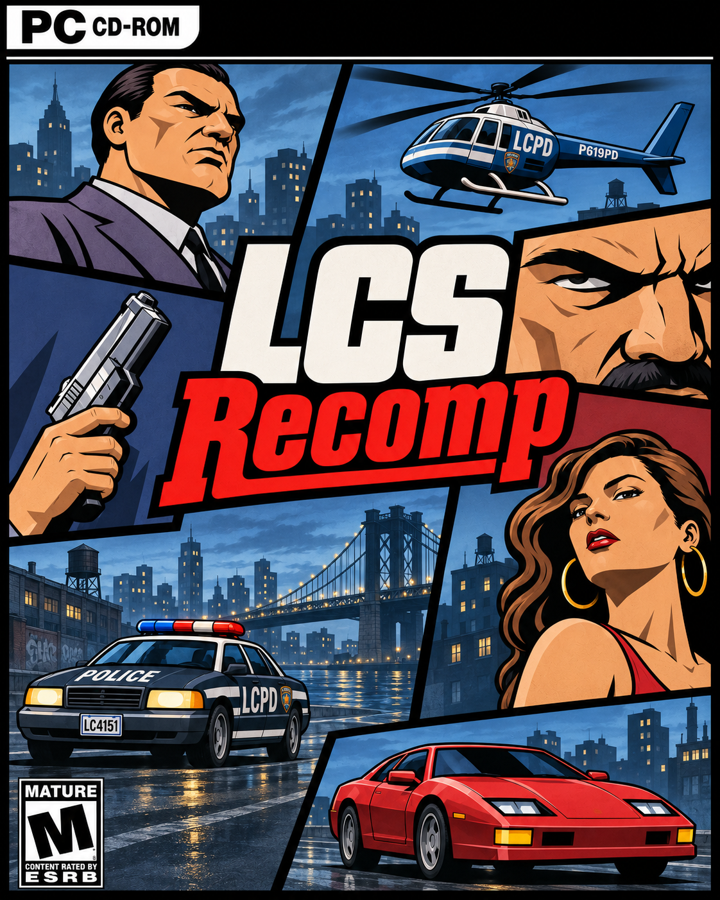
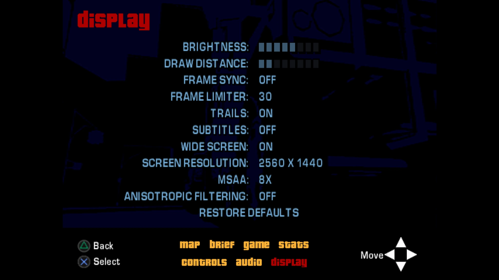
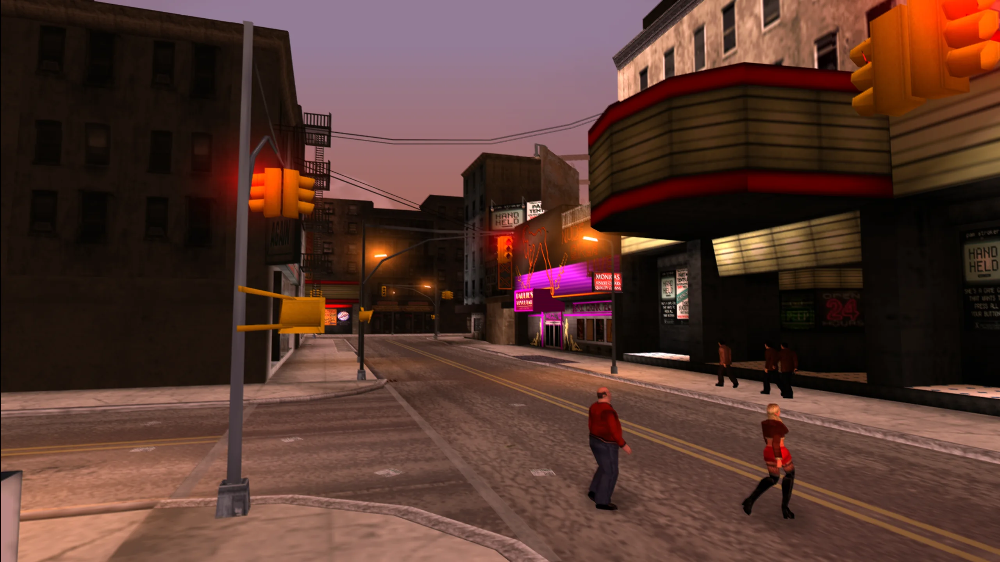

<h1 align="center">LCS Recomp</h1>

<p align="center">
  
</p>

<h3 align="center">Liberty City Stories. Recompiled for PC.</h3>

<p align="center">
  An unofficial native PC recompilation of the PlayStation 2 version of Grand Theft Auto: Liberty City Stories.
</p>

<p align="center">
  
  
  
  
  
  
</p>

<p align="center">
  <a href="#latest-release"><strong>Download</strong></a> ·
  <a href="https://github.com/NicoWayne95/lcs-ps2-recomp/releases/tag/v0.2.1">Release Notes</a> ·
  <a href="#whats-new">What's New</a> ·
  <a href="#features">Features</a> ·
  <a href="#known-issues">Known Issues</a> ·
  <a href="#roadmap">Roadmap</a>
</p>

<p align="center">
  <a href="#installation">Installation</a> ·
  <a href="#screenshots">Screenshots</a> ·
  <a href="#source-code">Source Code</a> ·
  <a href="https://github.com/NicoWayne95/lcs-ps2-recomp/discussions">Discussions</a> ·
  <a href="https://github.com/NicoWayne95/lcs-ps2-recomp/issues">Report a Bug</a>
</p>

---

## Welcome back to Liberty City!

**LCS Recomp** is an independent fan project bringing the PlayStation 2 version of Grand Theft Auto: Liberty City Stories to PC through static recompilation and a custom native runtime.

The project aims to preserve the original game's atmosphere, gameplay and visual identity while introducing optional improvements for modern PC hardware.

Rather than replacing the original experience, the goal is to give players the freedom to choose between an authentic PlayStation 2 experience and an enhanced native PC experience.

LCS Recomp is developed as a personal hobby project in my free time. It is my first recompilation project of this kind, and development is an ongoing learning process.

The game is prepared and recompiled locally using your own original PlayStation 2 game ISO. No original copyrighted game files are included.

> [!IMPORTANT]
> **LCS Recomp is currently in Public Beta.**
>
> Bugs, crashes, graphical issues, incomplete features and compatibility problems may still occur.
>
> Development is ongoing, and not every gameplay feature has been fully validated.

---

## Latest Release

### v0.2.1 — Quality of Life Update

**Released November 20, 2026**

Version 0.2.1 introduces significant gameplay improvements, high-FPS timing corrections, controller compatibility improvements and changes to the native rendering architecture.

The update also introduces AVX1 as the standard Windows game build target, with the goal of improving compatibility with older processors.

| Information | Details |
| :--- | :--- |
| Current Release | **v0.2.1 — Quality of Life Update** |
| Release Status | Public Beta |
| Platform | Windows 10 / 11 (64-bit) |
| Renderer | DirectX 11 |
| CPU Baseline | AVX1, older hardware testing ongoing |
| Distribution | Existing portable launcher with integrated game updates |
| Launcher Update | Successfully tested |
| Game Launch After Update | Successfully tested |
| Development | Active |

<p align="center">
  <a href="https://github.com/NicoWayne95/lcs-ps2-recomp/releases/tag/v0.2.0-beta">
    
  </a>
  <a href="https://github.com/NicoWayne95/lcs-ps2-recomp/releases/tag/v0.2.1">
    
  </a>
</p>

> [!TIP]
> **Already using v0.2.0?**
>
> You do not need to download or reinstall the launcher.
>
> Open your existing LCS Recomp Launcher and use its integrated update system to install v0.2.1.
>
> The update installation and subsequent game launch have been successfully tested.

> [!NOTE]
> New players should download the portable launcher from the v0.2.0 beta release first.
>
> The v0.2.1 release contains the game update package used by the launcher, not a replacement standalone launcher.

**Recommended gameplay configuration:** 60 FPS with a controller using the Classic control scheme.

Higher frame rates remain experimental.

[Read the complete v0.2.1 changelog](https://github.com/NicoWayne95/lcs-ps2-recomp/releases/tag/v0.2.1)

---

## What's New

### v0.2.1 at a Glance

The Quality of Life Update focuses on improving the actual gameplay experience while also introducing important technical changes to the PC runtime.

| Category | Improvements |
| :--- | :--- |
| **Rendering Architecture** | Optimized native world render path and persistent GPU vertex buffers |
| **Rendering Pipeline** | Reduced GS processing overhead and optimized draw submission |
| **CPU Compatibility** | AVX1 replaces AVX2 as the standard game build target |
| **Controller Support** | Improved Xbox and PlayStation compatibility |
| **Input Switching** | Seamless controller and keyboard/mouse switching during gameplay |
| **DualShock 3** | Native pressure-sensitive acceleration, braking and steering |
| **Adaptive Input Prompts** | Automatic prompts for supported PlayStation, Xbox and keyboard/mouse controls |
| **Vehicle Camera** | Free mouse-controlled exterior camera with improved collision handling |
| **Mouse Controls** | Corrected mouse inversion and improved camera behavior |
| **HUD & Widescreen** | Corrected radar alignment, sniper scope positioning and wanted star timing |
| **High-FPS Gameplay** | Numerous physics, animation and particle timing corrections |
| **Launcher Updates** | Successfully tested v0.2.1 installation through the existing launcher |

### Controls & Input Improvements

Version 0.2.1 introduces several improvements to controller support and input handling.

**Seamless Controller Switching**

Players can now switch between supported input devices during gameplay without restarting the game.

- Switch between connected controllers.
- Switch between controller and keyboard/mouse input.
- Automatic detection of the active input device.
- No manual input mode selection required for supported devices.
- Adaptive button prompts update when the active device changes.
- Improved fallback behavior when controllers disconnect.

**Xbox & PlayStation Support**

- Improved Xbox controller support through XInput.
- PlayStation controller integration through HIDAPI.
- Improved controller detection and input processing.
- Adjusted Xbox analog stick sensitivity while aiming.
- Improved controller connection and disconnection handling.

**DualShock 3 Pressure-Sensitive Controls**

Native pressure-sensitive input is now supported for compatible DualShock 3 controllers.

| Action | Function |
| :--- | :--- |
| Acceleration | Analog pressure-sensitive throttle |
| Braking | Analog pressure-sensitive braking |
| Steering | Pressure-sensitive directional pad steering |

The response curves have been adjusted to improve usability.

Full acceleration and braking are reached at approximately 37% of the reported pressure range, while steering reaches full output at approximately 47%.

This functionality has been successfully tested in gameplay.

Compatible drivers exposing analog button pressure values are required.

**Adaptive Button Prompts**

The game now automatically displays supported input prompts depending on the active input device.

- PlayStation 5 / DualSense.
- PlayStation / DualShock.
- Xbox controllers.
- Keyboard and mouse.

Adaptive prompts are implemented in supported gameplay and UI paths.

Some original button prompts are still present in the pause menu and require further investigation.

### Camera, Mouse & HUD Improvements

**Free Vehicle Camera**

The exterior vehicle camera can now be rotated freely using the mouse without holding the right mouse button.

Improvements include:

- Free horizontal and vertical movement.
- Smooth automatic camera recentering.
- Improved wall and environmental collision handling.
- Automatic camera distance adjustment near obstacles.
- Improved camera movement and angle restrictions.

**Mouse Controls**

- Corrected mouse inversion behavior.
- Improved camera and aiming consistency.
- Added separate vertical camera limits for vehicles and third-person free aim.

Full native mouse free aim remains under development.

**HUD & Widescreen**

- Fixed radar map positioning.
- Corrected alignment between radar map, outer ring and markers.
- Improved HUD coordinate handling.
- Corrected sniper scope positioning.
- Improved upper-right HUD alignment.

The Screen Edges HUD layout is now the default for 16:9 gameplay, while 4:3 retains the original native coordinates.

---

## Rendering and Performance

Version 0.2.1 introduces substantial changes to the native rendering pipeline.

The objective is to reduce unnecessary CPU processing, improve rendering efficiency and establish a stronger foundation for future optimizations.

### Native Render Path Improvements

The rendering pipeline now includes a more direct path for eligible static world geometry.

Implemented improvements include:

- Persistent GPU vertex buffers for static world geometry.
- Reuse of immutable vertex data.
- Direct rendering paths for verified opaque world geometry.
- Reduced general-purpose VU1 dispatch for eligible draws.
- Reduced GS queue payload sizes.
- Grouping of consecutive static world rendering operations.
- Processing of up to eight consecutive eligible static world draws together.

These changes aim to reduce CPU-side overhead and improve rendering command submission.

The optimized path is only used for geometry that meets the required conditions.

Other rendering operations continue using their existing processing paths where necessary to preserve compatibility and rendering accuracy.

### Performance Improvements

Ongoing optimization work focuses on:

- Reducing CPU-side rendering overhead.
- Improving Render Worker efficiency.
- Reducing unnecessary memory copying.
- Improving GS command processing.
- Reducing synchronization overhead.
- Improving frame pacing.
- Reducing rendering-related stuttering.

Initial gameplay testing showed improvements in certain scenarios.

However, further controlled benchmarks are required before consistent FPS or frame-time improvements can be quantified.

The Render Worker, Graphics Synthesizer and Emotion Engine can still place significant load on the CPU in demanding situations.

> [!NOTE]
> The rendering changes represent important architectural improvements.
>
> They do not guarantee higher FPS in every scene or on every hardware configuration.

### AVX1 CPU Compatibility

**The Windows game build now targets AVX1 instead of requiring AVX2 as its standard instruction set.**

This change is intended to improve compatibility with older processors that support AVX but not AVX2.

- Updated the Windows build target to AVX1.
- Reduced reliance on AVX2 as the baseline requirement.
- Successfully compiled AVX1 development builds.
- Completed build integrity verification.

> [!IMPORTANT]
> **Community testing is still required.**
>
> Compatibility with every AVX1-only processor has not yet been confirmed.
>
> If your CPU supports AVX but not AVX2, please test LCS Recomp and share your results.

### Vehicle Reflections

The vehicle reflection setting defaults to **As on PS2**, preserving the original reflection appearance.

Experimental adjustments that produced undesirable results were reverted.

[Read the full technical changes](https://github.com/NicoWayne95/lcs-ps2-recomp/releases/tag/v0.2.1)

---

## High-FPS Fixes

The original PlayStation 2 version was designed around a 30 FPS timing model.

Running the game at higher frame rates can expose calculations and animations that depend on the number of frames rather than elapsed time.

Version 0.2.1 includes numerous corrections intended to improve consistency at higher frame rates.

All major timing-related fixes are grouped below.

| System | Improvement |
| :--- | :--- |
| Vehicle Rolling Resistance | Corrected timestep scaling above 30 FPS |
| Parked Vehicle Collisions | Fixed excessive pushing at higher FPS |
| Wanted Stars | Corrected blinking speed |
| Player Idle Animations | Corrected animation timing |
| Exhaust Smoke | Improved timing |
| Burnout & Tire Smoke | Improved lifetime and fading |
| Clouds | Corrected drift and rotation timing |
| Water | Corrected surface texture animation timing |
| Scrolling Signs | Improved frame rate-independent animation |
| Rain, Dust & Sparks | Improved selected particle timing calculations |

### Vehicle Physics

- Corrected passive rolling resistance above 30 FPS.
- Improved vehicle momentum consistency.
- Applied timestep-based corrections to cars and motorcycles.
- Fixed excessive movement of parked vehicles when the player runs into them.

The parked-car collision correction and improved car rolling behavior have been confirmed in gameplay.

Additional motorcycle-specific testing remains useful.

### Wanted Level Timing

- Corrected excessively fast blinking of newly acquired wanted stars.
- Updated blinking to use monotonic real-time timing.
- Wanted star colors now change every 250 milliseconds.

### Particle & Environmental Animations

- Improved exhaust smoke timing.
- Corrected burnout and tire smoke behavior.
- Improved selected particle lifetime and fading.
- Corrected cloud drift and rotation timing.
- Improved water texture animation timing.
- Corrected scrolling sign and animated board timing.
- Improved timing for selected rain, dust and spark effects.
- Corrected player idle animation timing.

> [!NOTE]
> Although many timing issues have been corrected, not every animation, particle effect, mission or cutscene has been fully validated at higher frame rates.
>
> Additional improvements remain planned.

---

## Features

The following overview describes functionality available in the current public beta.

Some options remain experimental or require further refinement.

<table>
<tr>
<td width="50%" valign="top">

### Graphics & Display

- Native DirectX 11 rendering
- Original PS2 rendering resolution
- 1080p, 1440p and 4K rendering options
- 16:9 widescreen support
- MSAA up to 8×
- Anisotropic filtering up to 16×
- Original PS2 trails
- Original glow effects
- Fullscreen and windowed modes
- VSync and VRR support

</td>
<td width="50%" valign="top">

### Performance & Gameplay

- 30 FPS
- 60 FPS
- Experimental 120 FPS
- Experimental uncapped FPS
- Improved frame pacing
- Expanded 64 MB game memory
- Playable open world
- Playable missions
- Original cutscenes
- Local savegames

</td>
</tr>
<tr>
<td width="50%" valign="top">

### Controls

- Classic controller configuration
- Xbox XInput support
- PlayStation HIDAPI support
- DualShock 3 pressure-sensitive buttons
- Native keyboard and mouse
- Seamless input device switching
- Adaptive button prompts
- Free mouse-controlled vehicle camera
- Mouse-controlled on-foot camera
- Mouse-wheel weapon switching
- Configurable mouse settings

</td>
<td width="50%" valign="top">

### PC Features

- Extended graphics settings
- Local configuration files
- Adjustable pedestrian draw distance
- Adjustable world fog distance
- Customizable savegame directory
- Integrated savegame backups
- Free Camera mode
- Toggleable HUD visibility
- Performance diagnostics
- Native audio and movie playback

</td>
</tr>
</table>

> [!NOTE]
> Higher rendering resolutions are available, but some text rendering issues remain above 1080p.
>
> Extended world geometry draw distance is not yet functioning correctly. The current settings should not be interpreted as a fully implemented draw distance enhancement.

### Audio

The native audio implementation supports:

- Original radio stations.
- Original music and sound effects.
- Ambient audio.
- Dialogue and mission audio.
- Cutscene audio.
- Original introductory movie playback.

Some features may still require further compatibility and stability testing.

---

## Two Ways to Experience Liberty City

The long-term vision for LCS Recomp is to offer both an authentic console experience and an enhanced native PC experience.

| Classic Experience | Enhanced PC Experience |
| :--- | :--- |
| Original PS2 visual identity | Higher rendering resolutions |
| Original rendering resolution | Up to 4K |
| Classic controller layout | Modern PC input options |
| Original 30 FPS timing | Higher frame rates |
| Pressure-sensitive controls | Native keyboard and mouse |
| Original visual effects | Additional graphics settings |
| Original camera behavior | Improved camera controls |
| Original world presentation | Extended draw distance (planned) |
| Authentic console experience | Potential future modding support |

Players should be able to decide how closely their experience resembles the original PlayStation 2 release.

These represent the development vision rather than two fully completed and independently implemented gameplay presets.

---

## Installation

### First-Time Installation

**New players should begin with the portable launcher from v0.2.0.**

1. Download the launcher from the [v0.2.0 Public Beta release](https://github.com/NicoWayne95/lcs-ps2-recomp/releases/tag/v0.2.0-beta).
2. Extract the portable archive to a writable directory.
3. Start **LCS Recomp Launcher**.
4. Open the **Installation** section.
5. Select your original PlayStation 2 game ISO.
6. Click **Check ISO** and validate the game.
7. Optionally select your preferred game installation directory.
8. Click **Prepare game**.
9. Allow the launcher to download the required tools and prepare the native PC executable.
10. Once preparation is complete, install any available game updates through the launcher.
11. Open **Home** and click **Play**.

No manual compilation or programming knowledge is required.

The original game ISO remains on your PC.

No original game files are uploaded.

### Updating from v0.2.0 to v0.2.1

> [!TIP]
> **Already have LCS Recomp installed?**
>
> You do not need to download or reinstall the launcher.

1. Open your existing LCS Recomp Launcher.
2. Check for the available v0.2.1 update.
3. Start the update.
4. Allow the launcher to download and verify the update package.
5. Wait for game preparation to finish.
6. Launch the game normally.

### Update Verification

The v0.2.1 update workflow has been successfully tested.

| Test | Result |
| :--- | :--- |
| Update Package Preparation | Passed |
| Ed25519 Signature Verification | Passed |
| Package Integrity Verification | Passed |
| Launcher Update Installation | Passed |
| Game Launch After Update | Passed |
| Basic Gameplay After Update | Passed |

The update was successfully installed, and the game launched and ran correctly afterward.

The launcher is designed to preserve existing savegames, configuration, game installation preferences and the original ISO.

Backing up savegames before updating is still recommended while the project remains in beta.

### Initial Preparation Requirements

Approximate requirements from the previous public beta:

| Requirement | Details |
| :--- | :--- |
| Build Tools Download | Approximately 257 MB |
| Free Disk Space | Approximately 6 GB |
| Preparation Time | Approximately 20–60 minutes |
| Internet Connection | Required |
| Manual Compilation | Not required |

These estimates may differ depending on hardware and release version.

### Supported Game Version

> [!IMPORTANT]
> You need your own legally obtained PlayStation 2 copy of Grand Theft Auto: Liberty City Stories in ISO format.
>
> **Supported version: USA / NTSC-U (SLUS-21423)**
>
> Other regional releases and the PSP version are currently unsupported.

### System Requirements

| Requirement | Details |
| :--- | :--- |
| Operating System | Windows 10 / 11 (64-bit) |
| Graphics API | DirectX 11 |
| CPU | AVX-capable processor; older AVX1-only hardware requires further testing |
| Game Version | PlayStation 2 — USA / NTSC-U |
| Game ID | SLUS-21423 |
| Game Format | Original game ISO |
| Internet | Required for initial preparation and updates |
| Launcher Runtime | Microsoft Edge WebView2 |

Minimum and recommended CPU, GPU and RAM specifications have not yet been established.

### Recommended Settings

| Setting | Recommendation |
| :--- | :--- |
| Frame Rate | 60 FPS |
| Input Device | Controller |
| Controller Layout | Classic |
| Resolution | 1920×1080 if affected by text rendering issues |

Higher frame rates remain experimental.

### Microsoft Edge WebView2

The launcher requires Microsoft Edge WebView2 Runtime.

Most Windows 10 and Windows 11 installations already include it.

If the launcher fails to open or displays a blank window, you may need to install it manually.

[Download Microsoft Edge WebView2 Runtime](https://developer.microsoft.com/microsoft-edge/webview2/)

### Windows SmartScreen

The launcher and installer are currently not Windows code-signed.

Windows SmartScreen may display an unknown publisher warning.

Only download LCS Recomp from the official GitHub repository and verify the source before running downloaded executables.

[View Releases & Installation Instructions](https://github.com/NicoWayne95/lcs-ps2-recomp/releases)

---

## Known Issues

LCS Recomp is still under active development.

The following issues have not been fully resolved in v0.2.1.

| Issue | Current Status |
| :--- | :--- |
| Texture & Object Flickering | Under investigation |
| Text Rendering Above 1080p | Not resolved |
| Pause Menu Button Prompts | Incomplete integration |
| Extended Draw Distance & LOD | Partially functional |
| Blue Beta Police Cars | Under investigation |
| Remaining High-FPS Behavior | Additional corrections required |
| Native Mouse Free Aim | Not yet complete |
| Older AVX1-Only CPU Compatibility | Additional testing required |
| Extended Gameplay Stability | Further validation required |

### Texture & Object Flickering

Certain textures and environmental details, including garage decals and building details, may flicker during gameplay.

Comparisons with PCSX2 indicate that affected assets render correctly in the original emulated game.

Changes to depth handling and decal rendering have reduced the problem in some experimental configurations, but the issue can return with optimized rendering paths.

Further investigation into rendering order and depth handling is required.

### Text Rendering Above 1080p

Some in-game text and UI elements may render incorrectly at resolutions above 1920×1080.

Possible symptoms include distorted characters, incorrect scaling and visual artifacts.

**Temporary workaround:** Try using 1920×1080.

### Pause Menu Button Prompts

Some original PS2 button prompts are still displayed in the pause menu instead of the new adaptive icons.

Adaptive prompts have been implemented and tested in supported gameplay paths, but pause-menu integration remains incomplete.

### Draw Distance, LOD & World Streaming

**Extended world draw distance is not yet functioning correctly.**

The game's original world streaming, Level of Detail selection and object visibility systems currently limit how effectively rendering distance can be extended.

Further work is required to improve:

- World streaming distances.
- Object loading and unloading.
- LOD transitions.
- Visibility and culling.
- Missing or prematurely disappearing geometry.
- Performance when extending draw distance.

The goal is to provide optional extended draw distance while preserving original PS2 behavior as the default.

### Blue Beta Police Cars

Restoring the blue beta police vehicles is currently blocked by a game-specific material color restriction.

The game's material handling appears to prevent certain police vehicle materials from being recolored.

Further investigation is required to identify and address this restriction without negatively affecting standard police vehicles, lighting and reflections.

The goal is to provide the alternative blue appearance as an optional feature.

### Remaining High-FPS Limitations

- Some particle and environmental effects require further refinement.
- Certain gameplay calculations may still depend on original frame timing.
- Not every mission and cutscene has been individually validated at higher frame rates.
- Frame rates above 240 FPS remain unsupported.

### Controls & Camera

- Full native mouse free aim remains under development.
- Some extreme vehicle camera angles still require refinement.
- Customizable keyboard and mouse bindings are not yet implemented.
- Controller compatibility may vary depending on hardware and drivers.

[View Known Issues & Report a Bug](https://github.com/NicoWayne95/lcs-ps2-recomp/issues)

---

## Roadmap

<p align="center">
  
</p>

The roadmap reflects the current development direction.

Priorities may change depending on technical feasibility, available development time and community feedback.

Features listed below are planned for future releases and are not included in v0.2.1 unless explicitly stated otherwise.

### In-Game Trainer & Function Key Overhaul

A larger redesign of the function key system is planned.

The goal is to separate gameplay settings, graphics configuration, performance monitoring, trainer functionality and developer diagnostics.

<details open>
<summary><b>Planned F1–F12 Layout</b></summary>

| Key | Planned Function | Description |
| :--- | :--- | :--- |
| `F1` | Help & Shortcuts | Controls and keyboard shortcut overview |
| `F2` | Video & HUD | Graphics settings, resolution, effects and HUD configuration |
| `F3` | Trainer | Player, weapons, vehicles, world and original cheats |
| `F4` | Performance | FPS, frame times, 1% lows and performance measurements |
| `F5` | Resolution | Cycle through rendering resolutions |
| `F6` | FPS Mode | Cycle through frame rate limits |
| `F7` | Trails | Toggle original PS2 trails |
| `F8` | Free Camera | Toggle free camera mode |
| `F9` | HUD | Show or hide the HUD |
| `F10` | Developer Diagnostics | Debugging tools and world dumps |
| `F11` | Fullscreen | Toggle fullscreen |
| `F12` | Screenshot | Capture gameplay screenshots |

### Planned Menu Behavior

- F1 through F4 open dedicated panels.
- Pressing the same key closes the active panel.
- Pressing `Esc` closes the active panel.
- F5 through F9 retain their direct shortcut functionality.
- F10 through F12 provide diagnostics, display control and screenshots.

The existing F1 Maverick helicopter spawn functionality is planned to move into the trainer's vehicle section.

The current v0.2.1 function key assignments remain unchanged.

</details>

### Integrated Trainer

<details>
<summary><b>Planned F3 Trainer</b></summary>

The planned in-game trainer will provide convenient access to gameplay and testing options without external trainer software.

| Category | Planned Functionality |
| :--- | :--- |
| Player | Player settings and gameplay options |
| Weapons | Weapon selection and ammunition |
| Vehicles | Vehicle spawning and related options |
| World | World and gameplay settings |
| Original Cheats | Access to original game cheat functionality |

The exact interface and feature set are still being designed.

**The trainer is not included in v0.2.1.**

</details>

### Graphics & Rendering

- Resolve texture and object flickering.
- Correct text rendering above 1080p.
- Complete adaptive prompts in the pause menu.
- Improve native rendering accuracy.
- Extend world geometry draw distance.
- Improve world streaming and LOD behavior.
- Restore optional blue beta police vehicles.
- Introduce additional graphics options.

### Performance & Compatibility

- Continue optimizing the native rendering pipeline.
- Reduce unnecessary CPU-side processing.
- Improve GS and Render Worker efficiency.
- Reduce unnecessary memory copying.
- Improve frame-time consistency.
- Reduce streaming-related stuttering.
- Improve performance on older hardware.
- Continue high-FPS timing corrections.
- Expand real-world AVX1 compatibility testing.

### Gameplay & Controls

- Complete native mouse free aim.
- Improve aiming and crosshair behavior.
- Implement customizable key bindings.
- Further refine vehicle camera behavior.
- Improve motorcycle handling.
- Expand controller compatibility.
- Expand mission and cutscene testing.

### Launcher Development

The launcher is being reworked as a dedicated component of the project.

A portable-first approach is planned for future versions.

Planned improvements include:

- Redesigned launcher interface.
- Improved visual presentation and animations.
- Portable ZIP distribution.
- More reliable game preparation.
- Improved dependency management.
- Better download and preparation progress.
- Improved error handling and diagnostics.
- Improved update and recovery functionality.
- Better separation between the launcher and game runtime.

The current launcher already supports the v0.2.1 update workflow.

The larger redesign is a future development effort.

### Long-Term Development

- Cleaner public source repository.
- Reproducible game and launcher builds.
- Better technical documentation.
- Community contributions and pull requests.
- More configurable Classic and Enhanced PC experiences.
- Further native runtime improvements.
- Investigation of modding and mod-loader support.
- Potential additional platform support, subject to feasibility.

No specific release dates are promised for individual planned features.

---

## Source Code

LCS Recomp is undergoing a major internal restructuring in preparation for more transparent open-source development.

The goal is to provide a cleaner, more maintainable public source repository that other developers can inspect, build and contribute to.

### Current Restructuring Work

- Separation of the game runtime and launcher.
- Organization of source code and third-party dependencies.
- Consistent and reproducible build processes.
- Dedicated development and testing workflows.
- Performance profiling and benchmarking infrastructure.
- Improved technical documentation.
- Review of third-party licenses and attribution.
- Removal of machine-specific paths and unrelated local files.
- Separation of copyrighted game data from distributable project code.

### Planned Development Structure

<details>
<summary><b>View Internal Project Structure</b></summary>

```text
lcs-ps2-recomp/
├── backups/
├── benchmarks/
├── bin/
│   └── current/
├── build/
├── docs/
│   └── performance/
├── game/
├── launcher/
├── releases/
├── tests/
├── tools/
│
├── .gitattributes
├── .gitignore
├── README.md
│
├── Build-Game.ps1
├── Build-Launcher.ps1
├── Build-Release.ps1
│
├── Start-Game.ps1
├── Start-Launcher.ps1
├── Start-Profiling.ps1
└── Test-Release.ps1
```

| Directory | Purpose |
| :--- | :--- |
| `game/` | Game recompilation and runtime components |
| `launcher/` | Launcher development |
| `tools/` | Build and development utilities |
| `tests/` | Testing and regression validation |
| `benchmarks/` | Performance measurements |
| `docs/` | Technical documentation |
| `bin/` | Current development builds |
| `build/` | Generated build output |
| `releases/` | Release preparation |
| `backups/` | Local development backups |

This represents the internal development environment, not necessarily the final public repository or end-user installation.

Local backups, personal files, generated artifacts and copyrighted game assets are not intended to become part of the public repository.

</details>

### Open-Source Development

The long-term goal is to enable:

- Publicly accessible project source code.
- Documented build instructions.
- Reproducible builds.
- Transparent development through GitHub.
- Community contributions.
- Independent testing and technical improvements.
- Collaboration within the recompilation community.

The complete reorganized development tree is not yet available through this repository.

Preparing the reorganized development repository is separate from satisfying any existing source-code distribution obligations associated with GPL-covered components included in released builds.

Existing license obligations continue to apply during the restructuring process.

No original copyrighted game assets or ISOs will be included.

No publication date for the completed restructuring is being announced.

---

## Screenshots

### PC Features & Settings

LCS Recomp introduces additional PC-focused settings and functionality while preserving the original game's visual identity.

The following screenshots showcase controller configuration, keyboard and mouse options and graphics settings.

Some screenshots may show earlier development versions.

<p align="center">
  <a href="docs/features/controls-overview.webp">
    
  </a>
  <a href="docs/features/mouse-keyboard-setup.webp">
    
  </a>
  <a href="docs/features/display-settings.webp">
    
  </a>
</p>

<p align="center">
  <a href="docs/FEATURES.md"><strong>View all PC feature screenshots</strong></a>
</p>

### Gameplay Screenshots

Explore Liberty City through screenshots captured during development.

<p align="center">
  <a href="docs/screenshots/lcpd-helicopter.webp">
    
  </a>
  <a href="docs/screenshots/sunset-railway.webp">
    
  </a>
  <a href="docs/screenshots/downtown-street.webp">
    
  </a>
</p>

<p align="center">
  <a href="docs/GALLERY.md"><strong>View the full screenshot gallery</strong></a>
</p>

---

## Community & Feedback

Community feedback is an important part of development.

Successful test results are just as valuable as bug reports.

I'm particularly interested in:

- Performance and frame pacing.
- Compatibility across different hardware configurations.
- AVX1-only processor support.
- Controller and keyboard/mouse behavior.
- Mission and cutscene compatibility.
- Savegame functionality.
- Graphical issues.
- Launcher reliability.
- Long-session stability.

When reporting a problem, please include:

- CPU, GPU and Windows version.
- Rendering resolution.
- Selected FPS limit.
- Controller or input device.
- Description of the issue.
- Steps to reproduce it.
- Screenshots or videos, if available.

For performance-related issues, press `F2` to access the internal performance overlay.

External FPS counters may measure host-window presentation rather than the game's actual internal frame rate.

<p align="center">
  <a href="https://github.com/NicoWayne95/lcs-ps2-recomp/discussions">
    
  </a>
  <a href="https://github.com/NicoWayne95/lcs-ps2-recomp/issues">
    
  </a>
</p>

Constructive feedback, technical suggestions and future contributions are always welcome.

---

## AI-Assisted Development

LCS Recomp is developed with the assistance of AI tools, including Claude and a locally running Qwen model.

These tools support research, code exploration, implementation, debugging, profiling and testing.

AI-generated code is not automatically considered correct or production-ready. Changes require technical review, integration and practical validation.

Development decisions, project direction, testing and responsibility remain mine.

This is a personal hobby and learning project, and AI-assisted development allows me to explore complex technical systems while continuously improving my own understanding.

---

## Credits

LCS Recomp builds upon the work of several open-source projects and their contributors.

Their work provided the technical foundation that made this project possible.

### PS2Recomp

[**PS2Recomp by ran-j**](https://github.com/ran-j/PS2Recomp)

Provides the static PlayStation 2 recompiler and foundational runtime used by LCS Recomp.

License: GPL-3.0.

### GTA: Vice City Stories Recomp

[**GTA: Vice City Stories Recomp by gothamor**](https://github.com/gothamor/gta-vcs-recomp)

As a technical reference  
License: GPL-3.0.

### HCTP Recomp

[**HCTP Recomp by BigDaddyJRich**](https://github.com/BigDaddyJRich/hctp-recomp)

Provides the foundation for the VU1 recompiler used within LCS Recomp.

License: GPL-3.0.

### Kenney

[**Input Prompts by Kenney**](https://kenney.nl/assets/input-prompts)

Provides the controller, keyboard and mouse icon assets used by the adaptive input prompt system.

License: [CC0 1.0 Universal](https://creativecommons.org/publicdomain/zero/1.0/)

### Special Thanks

Special thanks to ran-j, gothamor, BigDaddyJRich, Kenney and all contributors to their respective projects.

I would also like to thank everyone who has downloaded the public beta, reported issues, provided technical feedback or shown interest in the development of LCS Recomp.

This project would not be possible without the work of the recompilation community.

### Third-Party Licenses

All incorporated third-party components remain subject to their applicable licenses and copyright notices.

Additional attribution and licensing information can be found in the `NOTICE.txt` included with the distribution.

---

## Legal Notice

LCS Recomp is an unofficial, independent fan development project.

It is not affiliated with, endorsed by or sponsored by Rockstar Games, Rockstar Leeds, Rockstar North, Take-Two Interactive, Sony Interactive Entertainment or Microsoft.

Grand Theft Auto, Liberty City Stories and all associated characters, trademarks and copyrighted assets belong to their respective owners.

No ownership of the original game or its assets is claimed.

The cover artwork displayed in this repository is unofficial concept artwork. Any age-rating-style symbol shown is not an official rating for this project.

No original game ISOs or copyrighted game assets are included with LCS Recomp.

Users are required to provide their own legally obtained copy of the original game.

---

<p align="center">
  <strong>Liberty City Stories. Recompiled for PC.</strong>
</p>

<p align="center">
  Developed in my free time, with the goal of preserving and enhancing the original experience.
</p>

<p align="center">
  <strong>See you in Liberty City!</strong>
</p>
