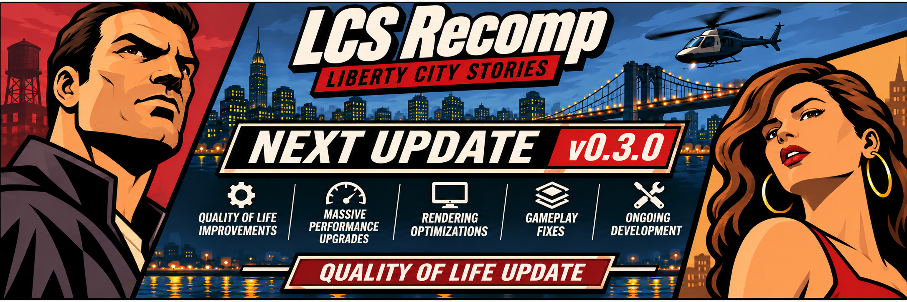
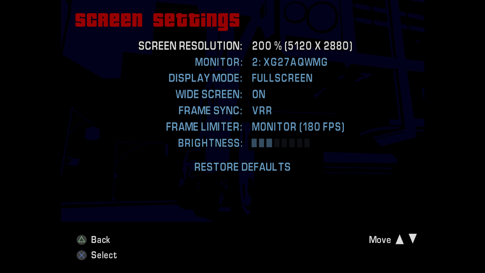
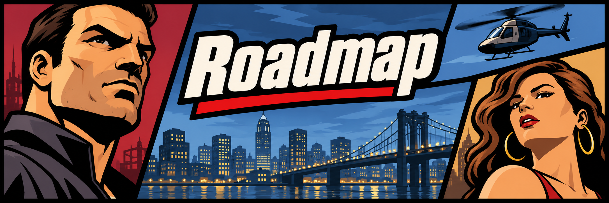

<h1 align="center">LCS Recomp</h1>

<p align="center">
  
</p>

<h3 align="center">Liberty City Stories. Recompiled for PC.</h3>

<p align="center">
  An unofficial native PC recompilation of<br>
  <strong>Grand Theft Auto: Liberty City Stories</strong><br>
  based on the original PlayStation 2 release.
</p>

<p align="center">
  
  
  
  
</p>

<p align="center">
  <a href="https://github.com/NicoWayne95/lcs-ps2-recomp/releases/latest">
    
  </a>
  <a href="https://github.com/NicoWayne95/lcs-ps2-recomp/commits/main/">
    
  </a>
  
  
  
</p>

<p align="center">
  <a href="https://github.com/NicoWayne95/lcs-ps2-recomp/releases/latest">
    
  </a>
  <a href="#installation">
    
  </a>
</p>

<p align="center">
  <a href="#project-status">Project Status</a> ·
  <a href="#latest-release">Latest Release</a> ·
  <a href="#development">Development</a> ·
  <a href="#features">Features</a> ·
  <a href="#performance">Performance</a>
</p>

<p align="center">
  <a href="#screenshots">Screenshots</a> ·
  <a href="#roadmap">Roadmap</a> ·
  <a href="#documentation">Documentation</a> ·
  <a href="#community">Community</a> ·
  <a href="#credits">Credits</a>
</p>

---

## Welcome back to Liberty City!

**LCS Recomp** brings the PlayStation 2 version of Grand Theft Auto: Liberty City Stories to PC through static recompilation and a custom native runtime.

The project aims to preserve the original game's atmosphere, gameplay and visual identity while introducing optional enhancements for modern PC hardware.

Experience Liberty City with higher rendering resolutions, improved performance, modern input options, configurable graphics settings and optional HD texture replacements.

> [!IMPORTANT]
> LCS Recomp is an independent, solo-developed fan project maintained in my spare time.
>
> Development includes reverse engineering, runtime improvements, optimization, debugging, testing and release management.

> [!WARNING]
> LCS Recomp is currently in **Public Beta**.
>
> Bugs, crashes, compatibility issues and incomplete features may still occur.
>
> You must provide your own supported PlayStation 2 game ISO. Original game files are not included.

---

## <a id="project-status"></a>Project Status


<div align="center">

<table>
  <tr>
    <td align="center" valign="top" width="240">
      <strong>Latest Public Release</strong>
      <br><br>
      <a href="https://github.com/NicoWayne95/lcs-ps2-recomp/releases/latest">
        
      </a>
      <br><br>
      Available for download
    </td>
    <td align="center" valign="top" width="240">
      <strong>Current Development</strong>
      <br><br>
      <a href="docs/updates/v0.3.1/README.md">
        
      </a>
      <br><br>
      Internal development build
    </td>
    <td align="center" valign="top" width="240">
      <strong>Project Activity</strong>
      <br><br>
      
      <br><br>
      Continuous improvements
    </td>
  </tr>
</table>

</div>


### Current Development Focus

| Development Area | Priority | Status |
| :--- | :---: | :--- |
| Performance optimization | High | Ongoing |
| Stability and compatibility | High | Ongoing |
| Memory management | High | Planned |
| Mouse aiming accuracy | High | Investigating |
| PC menu improvements | High | Development build |
| Launcher redesign | Medium | Planned |
| Extended world draw distance | Medium | Planned |
| Native HDR rendering | Long-term | Planned |

<p align="center">
  <a href="#development"><strong>Development Activity</strong></a> ·
  <a href="#roadmap"><strong>Project Roadmap</strong></a> ·
  <a href="https://github.com/NicoWayne95/lcs-ps2-recomp/issues"><strong>Issue Tracker</strong></a>
</p>

---

## <a id="latest-release"></a>Latest Public Release

<p align="center">
  
</p>

<h3 align="center">v0.3.0 — Performance & Quality of Life Update</h3>

<p align="center">
  
  
</p>

One of the largest technical updates to LCS Recomp so far, introducing substantial improvements to rendering performance, frame pacing, resource management and PC-focused features.

| Performance & Rendering | Features & Quality of Life |
| :--- | :--- |
| Reduced CPU rendering overhead | PCSX2-compatible HD texture packs |
| Optimized native rendering paths | SMAA anti-aliasing |
| Improved frame pacing | Configurable HDR output |
| Faster resource processing | Adjustable text size |
| Improved world streaming | Controller vibration |
| Reduced unnecessary GPU work | Automatic monitor detection |

<p align="center">
  <a href="https://github.com/NicoWayne95/lcs-ps2-recomp/releases/tag/v0.3.0">
    
  </a>
  <a href="https://github.com/NicoWayne95/lcs-ps2-recomp/releases/latest">
    
  </a>
</p>

> [!TIP]
> Already have LCS Recomp installed?
>
> Open your existing launcher and check for the latest compatible game update. Reinstalling the launcher is normally not required.

<p align="center">
  <a href="docs/updates/README.md">Browse Previous Updates</a>
</p>

---

## <a id="development"></a>Development Activity

<p>
  
  
</p>

Development continues between public releases.

The next update focuses on further refining the PC experience, improving existing systems and addressing community-reported issues.

### Recent Development Highlights

| Development | Description | Status |
| :--- | :--- | :--- |
| Expanded PC menus | Reorganized controls and display configuration | Implemented in development build |
| Screen settings | Monitor selection, resolution scaling and frame synchronization | Development build |
| Graphics settings | Dedicated rendering configuration | Development build |
| HDR settings | Dedicated HDR configuration menu | Development build |
| Interface settings | HUD layout, visibility and text scaling | Development build |
| Extras menu | Additional optional enhancements | Development build |
| Beta police cars | Optional blue and white LCPD appearance | Visually implemented |
| Frame-rate limit | Maximum gameplay frame rate of 180 FPS | Development build |
| Mouse aiming | Investigation of crosshair and projectile inconsistencies | Investigating |
| Memory management | Further resource and memory optimization | Planned |
| Launcher | New architecture and faster preparation workflow | Planned |

> [!NOTE]
> Development features may not yet be included in the latest public release. Implementation, testing and release readiness are separate development stages.

### Development Resources

| Resource | Description |
| :--- | :--- |
| [v0.3.1 Development Showcase](docs/updates/v0.3.1/README.md) | Upcoming changes and development screenshots |
| [Update History](docs/updates/README.md) | Previous updates and development milestones |
| [Repository Activity](https://github.com/NicoWayne95/lcs-ps2-recomp/commits/main/) | Recent public repository commits |
| [Open Issues](https://github.com/NicoWayne95/lcs-ps2-recomp/issues) | Bug reports and feature requests |
| [Discussions](https://github.com/NicoWayne95/lcs-ps2-recomp/discussions) | Community feedback and development discussions |

---

## <a id="features"></a>Key Features

<table>
  <tr>
    <td width="50%" valign="top">
      <h3>Graphics & Display</h3>
      <ul>
        <li>DirectX 11 rendering</li>
        <li>Internal resolution scaling</li>
        <li>Widescreen support</li>
        <li>SMAA, SMAA 2X and SMAA 4X</li>
        <li>16× anisotropic filtering</li>
        <li>Configurable vehicle reflections</li>
        <li>Original trails and glow effects</li>
        <li>Configurable HDR output</li>
      </ul>
    </td>
    <td width="50%" valign="top">
      <h3>Performance & Gameplay</h3>
      <ul>
        <li>Playable open-world gameplay</li>
        <li>Original missions and cutscenes</li>
        <li>High-refresh-rate gameplay</li>
        <li>Optimized native rendering paths</li>
        <li>Improved frame pacing</li>
        <li>Improved world streaming</li>
        <li>Resource management improvements</li>
        <li>Local savegames and backups</li>
      </ul>
    </td>
  </tr>
  <tr>
    <td width="50%" valign="top">
      <h3>Controls & Input</h3>
      <ul>
        <li>Xbox controller support</li>
        <li>PlayStation controller support</li>
        <li>Native keyboard and mouse input</li>
        <li>Adjustable controller vibration</li>
        <li>Adaptive button prompts</li>
        <li>Mouse-wheel weapon switching</li>
        <li>Mouse-controlled camera</li>
        <li>Classic controller configurations</li>
      </ul>
    </td>
    <td width="50%" valign="top">
      <h3>PC Enhancements</h3>
      <ul>
        <li>Compatible PCSX2 texture packs</li>
        <li>Adjustable text size</li>
        <li>Toggleable HUD</li>
        <li>Automatic monitor detection</li>
        <li>Free Camera mode</li>
        <li>Native audio and video playback</li>
        <li>Persistent configuration</li>
        <li>Performance diagnostics</li>
      </ul>
    </td>
  </tr>
</table>

<p align="center">
  <a href="docs/FEATURES.md">
    
  </a>
</p>

<details>
<summary><strong>HD Texture Pack Support</strong></summary>

<br>

LCS Recomp supports compatible PCSX2 texture replacement packs for supported textures.

Features include:

- Automatic recognition of supported replacement textures.
- Support for 4-bit and 8-bit palettized textures.
- HD HUD elements, icons, radar, maps and fonts.
- Background texture loading.
- Original textures remain visible until replacements are ready.

### Installation

Place the texture pack's `SLUS-21423` folder inside the `textures` directory next to `LCSrecomp.exe`.

```text
LCS Recomp/
├── LCSrecomp.exe
└── textures/
    └── SLUS-21423/
        └── replacements/
            └── ...
```

HD texture packs are optional and are not distributed with LCS Recomp.

Compatibility with individual texture packs may vary.

</details>

<details>
<summary><strong>HDR Output — Stage 1</strong></summary>

<br>

LCS Recomp supports configurable HDR presentation on compatible displays.

Available configuration options include:

- Paper-white brightness.
- Peak brightness.
- Highlight intensity.
- Highlight start.
- Saturation.

The current HDR implementation enhances the original game's SDR presentation for HDR-compatible displays.

It is not a fully native HDR rendering pipeline.

Native HDR rendering remains a long-term development goal.

Enabling or disabling HDR output requires a game restart.

</details>

<details>
<summary><strong>Controller Compatibility & Original Input Behavior</strong></summary>

<br>

LCS Recomp aims to preserve the original controller experience while introducing additional PC input options.

Supported configurations include:

- Compatible Xbox controllers.
- Compatible PlayStation controllers.
- Adjustable controller vibration.
- Adaptive controller button prompts.
- Native keyboard and mouse input.

Original DualShock-style button glyphs can be displayed through compatible HD HUD texture packs.

Pressure-sensitive DualShock 3 input requires compatible drivers. Actual behavior depends on the controller, driver configuration and game input implementation.

</details>

<details>
<summary><strong>Native Audio & Video</strong></summary>

<br>

Native audio and video implementations support the original game's:

- Radio stations.
- Music and sound effects.
- Ambient audio.
- Dialogue and mission audio.
- Cutscene audio.
- Introductory movie playback.

</details>

---

## <a id="performance"></a>Rendering & Performance

Performance optimization is one of the main development priorities of LCS Recomp.

The runtime combines recompiled PlayStation 2 game code with increasingly optimized native PC implementations.

### Performance Highlights

<table>
  <tr>
    <td align="center" width="33%">
      <strong>Traffic-Heavy Benchmark</strong>
      <br><br>
      <h2>+60–70%</h2>
      Higher measured FPS
    </td>
    <td align="center" width="33%">
      <strong>Frame Time</strong>
      <br><br>
      <h2>~4.5–4.8 ms</h2>
      Compared with ~7.5–7.8 ms
    </td>
    <td align="center" width="33%">
      <strong>Frame Pacing</strong>
      <br><br>
      <h2>0.1%</h2>
      Frames exceeding 10 ms
    </td>
  </tr>
</table>

These results represent historical internal benchmarks collected during v0.3.0 development on an NVIDIA RTX 4090 system.

Actual performance improvements depend on hardware, graphics settings, resolution and scene complexity.

### Optimization Areas

| Area | Improvements |
| :--- | :--- |
| Native Rendering | World geometry, vehicles, skinning and GPU resource reuse |
| CPU Efficiency | Scheduling, allocations and command submission |
| Frame Presentation | Synchronization and reduced rendering queue depth |
| GPU Efficiency | Reduced redundant uploads and unnecessary processing |
| World Streaming | Persistent decompression cache and asynchronous processing |
| Resource Management | Mesh caching, texture reuse and background cleanup |

<details>
<summary><strong>View Detailed Internal Benchmark Results</strong></summary>

<br>

| Test Scenario | Previous Build | v0.3.0 Benchmark |
| :--- | ---: | ---: |
| Portland Police Station — heavy traffic | ~130 FPS | **~210–225 FPS** |
| Frame time in the same scene | ~7.5–7.8 ms | **~4.5–4.8 ms** |
| Command-chain buffer reuse | 118 FPS | **145 FPS** |
| Frames exceeding 10 ms | 3.3% | **0.1%** |
| Free camera — ground toward water | 247 FPS | **330 FPS** |
| Free camera — above the city | 154 FPS | **170 FPS** |
| Free camera — toward another island | 224 FPS | **277 FPS** |

> [!NOTE]
> These are historical development benchmarks, not guaranteed gameplay performance.
>
> Results above 180 FPS were obtained using internal benchmark configurations.
>
> The current v0.3.1 development build enforces a maximum gameplay frame rate of 180 FPS.

</details>

<details>
<summary><strong>View Technical Rendering Architecture</strong></summary>

<br>

Current native rendering and runtime improvements include:

- Native rendering of eligible static world geometry.
- Persistent GPU buffers for supported world meshes.
- Shared vehicle geometry.
- Native shader-based vehicle environment mapping.
- Optimized character and vehicle skinning.
- Faster mesh identification and visibility checks.
- Reduced PlayStation 2 Graphics Synthesizer overhead.
- Improved synchronization between native and PS2-oriented rendering paths.

The native rendering paths are used where their behavior has been sufficiently validated.

Compatible fallback paths remain available for operations that require them.

### Resource Management

- Reference-based texture processing.
- Redundant texture upload detection.
- Improved palette reuse.
- Expanded GPU mesh caching.
- Incremental cache eviction.
- Asynchronous texture processing.
- Reusable command buffers.

### World Streaming

- Persistent level decompression caching.
- Additional texture worker threads.
- Reduced main-thread resource creation.
- Background cache cleanup.
- Improved loading behavior during island transitions.

</details>

<details>
<summary><strong>CPU Compatibility & Optimization</strong></summary>

<br>

The launcher automatically selects an appropriate build configuration during game preparation.

- AVX2-optimized builds for compatible processors.
- AVX-compatible builds for older supported processors.

No manual CPU optimization selection is normally required.

Actual compatibility depends on the complete CPU and operating system configuration.

</details>

---

## <a id="screenshots"></a>Screenshots

Experience Liberty City with its original visual identity and optional PC-focused enhancements.

> [!NOTE]
> The latest screenshots were captured with an optional **HD HUD texture pack** enabled.
>
> HD texture packs are not included with LCS Recomp.
>
> Some screenshots represent internal development builds.

### PC Features & Settings

<p align="center">
  <a href="docs/updates/v0.3.1/screenshots/menu-controller-setup.png">
    
  </a>
  <a href="docs/updates/v0.3.1/screenshots/menu-screen-settings.png">
    
  </a>
  <a href="docs/updates/v0.3.1/screenshots/menu-graphics-settings.png">
    
  </a>
</p>

<p align="center">
  <sub>Controller configuration · Screen settings · Graphics settings</sub>
</p>

<p align="center">
  <a href="docs/FEATURES.md">
    
  </a>
</p>

### Gameplay Screenshots

<p align="center">
  <a href="docs/updates/v0.3.1/screenshots/beta-police-car-side.png">
    
  </a>
  <a href="docs/screenshots/sunset-railway.webp">
    
  </a>
  <a href="docs/screenshots/downtown-street.webp">
    
  </a>
</p>

<p align="center">
  <sub>Beta police car appearance · Liberty City sunset · Downtown streets</sub>
</p>

<p align="center">
  <a href="docs/GALLERY.md">
    
  </a>
</p>

---

## <a id="installation"></a>Getting Started

### System Requirements

| Requirement | Details |
| :--- | :--- |
| Operating System | Windows 10 / Windows 11 (64-bit) |
| Graphics API | DirectX 11 |
| CPU | AVX-capable x64 processor |
| CPU Optimization | Automatic AVX / AVX2 selection |
| Game Version | PlayStation 2 — USA / NTSC-U |
| Game ID | SLUS-21423 |
| Required Game Files | Original supported ISO |
| Launcher Runtime | Microsoft Edge WebView2 |
| Internet Connection | Required for initial preparation and updates |

Definitive minimum and recommended CPU, GPU and RAM specifications have not yet been established through broad hardware testing.

> [!IMPORTANT]
> Only the supported USA / NTSC-U PlayStation 2 version is currently supported.
>
> Other regional versions and the PSP release are not supported.

### Quick Installation

1. Download the latest portable release.
2. Extract the archive into a writable folder.
3. Follow the included `START-HERE.txt`.
4. Start the LCS Recomp Launcher.
5. Open the Installation section.
6. Select and validate your original supported PS2 ISO.
7. Choose your installation directory.
8. Select **Prepare game**.
9. After preparation is complete, open Home and select **Play**.

No manual compilation or programming knowledge is required for normal installation.

<p align="center">
  <a href="https://github.com/NicoWayne95/lcs-ps2-recomp/releases/latest">
    
  </a>
</p>

<details>
<summary><strong>Updating an Existing Installation</strong></summary>

<br>

1. Open the existing LCS Recomp Launcher.
2. Check for available updates.
3. Install the latest compatible game update.
4. Allow download, verification and preparation to complete.
5. Start the game normally.

Launcher updates and game updates are separate.

Backing up savegames before major updates is recommended.

</details>

<details>
<summary><strong>Recommended Gameplay Settings</strong></summary>

<br>

| Setting | Recommendation |
| :--- | :--- |
| Frame Rate | 60 FPS as a conservative baseline |
| Input Device | Controller |
| Controller Layout | Classic |
| Resolution | Adjust according to available performance |
| Anti-Aliasing | SMAA |
| Texture Filtering | Adjust according to GPU performance |
| HD Textures | Optional |
| HDR | Optional on compatible displays |

Higher frame rates remain experimental in some gameplay scenarios.

</details>

<details>
<summary><strong>Troubleshooting & Launcher Requirements</strong></summary>

<br>

### Microsoft Edge WebView2

The current launcher requires Microsoft Edge WebView2 Runtime.

If the launcher fails to start or displays an empty window, the runtime may need to be installed.

[Download Microsoft Edge WebView2](https://developer.microsoft.com/microsoft-edge/webview2/)

### Windows SmartScreen

The distributed executables are not currently Windows code-signed.

Windows may display an unknown publisher warning.

Only download LCS Recomp from the official repository and verify downloaded files before execution.

</details>

---

## Known Issues & Limitations

LCS Recomp remains under active development.

| Area | Current Limitation |
| :--- | :--- |
| Mouse Aiming | Crosshair and projectile accuracy require further improvements |
| World Draw Distance | Original streaming and LOD limitations remain |
| High-FPS Gameplay | Further mission, animation and physics validation required |
| HDR | Additional UI brightness and presentation work required |
| Memory Management | Further optimization planned |
| Hardware Compatibility | Additional testing on older hardware required |
| HD Texture Packs | Compatibility may vary between replacement packs |
| Stability | Long-session and mission compatibility testing remains ongoing |

For individual bugs and current investigations, refer to the GitHub issue tracker.

<p align="center">
  <a href="https://github.com/NicoWayne95/lcs-ps2-recomp/issues">
    
  </a>
  <a href="https://github.com/NicoWayne95/lcs-ps2-recomp/issues/new/choose">
    
  </a>
</p>

---

## <a id="roadmap"></a>Development Roadmap

<p align="center">
  
</p>

Development focuses on performance, stability, compatibility and optional PC enhancements while preserving the original gameplay experience.

### Active Development Priorities

| Development Area | Status |
| :--- | :--- |
| Native rendering optimization | Ongoing |
| CPU and GPU efficiency | Ongoing |
| Performance on older hardware | Ongoing |
| Stability and compatibility testing | Ongoing |
| PC settings and menu improvements | Development build |
| Mouse aiming accuracy | Investigating |
| Memory usage optimization | Planned |

### Upcoming Development Goals

| Feature | Development Goal |
| :--- | :--- |
| Launcher Redesign | New architecture and improved usability |
| Faster Game Preparation | Reduced compilation and installation times |
| Extended Draw Distance | Improved streaming and LOD handling |
| Controller Support | Additional compatibility and refinements |
| Gameplay Timing | Further high-FPS compatibility improvements |
| HD Texture Support | Expanded replacement compatibility |
| Developer Tools | Improved diagnostics and inspection tools |

### Long-Term Goals

| Feature | Development Goal |
| :--- | :--- |
| Native HDR Rendering | Fully native HDR rendering pipeline |
| Cross-Platform Launcher | Linux and macOS launcher compatibility |
| Additional Runtime Platforms | Investigation of native platform support |
| Modding | Improved modding and asset inspection capabilities |
| Trainer System | Optional in-game gameplay and developer tools |
| Build Reproducibility | Cleaner and more accessible development workflows |

<details>
<summary><strong>Detailed Rendering & Graphics Roadmap</strong></summary>

<br>

- Improve native rendering accuracy.
- Reduce remaining PS2 Graphics Synthesizer overhead.
- Improve synchronization between native and fallback rendering paths.
- Optimize world geometry processing.
- Improve vehicle reflection accuracy and efficiency.
- Develop functional extended world draw distance.
- Improve HDR presentation and UI brightness.
- Investigate native HDR rendering.
- Expand texture replacement compatibility.

</details>

<details>
<summary><strong>Detailed Performance & Compatibility Roadmap</strong></summary>

<br>

- Reduce CPU-side rendering overhead.
- Optimize render worker and GS processing stages.
- Reduce unnecessary memory transfers.
- Improve memory allocation and resource lifetime management.
- Improve performance on older CPUs and GPUs.
- Improve frame-time consistency.
- Expand profiling and diagnostics.
- Improve long-session stability.
- Expand mission and hardware compatibility testing.

</details>

<details>
<summary><strong>Detailed Launcher Roadmap</strong></summary>

<br>

A new launcher architecture is planned.

Development goals include:

- Redesigned user interface.
- Improved installation workflows.
- Faster game preparation.
- More efficient compilation.
- Improved dependency management.
- Clearer download and build progress.
- Improved error reporting.
- Improved recovery options.
- Better update management.
- Linux and macOS launcher compatibility.

Cross-platform launcher support does not automatically provide native game runtime support on those platforms.

</details>

> [!NOTE]
> Roadmap items represent development goals, not confirmed release commitments.
>
> No specific release dates are promised for individual features.

---

## <a id="documentation"></a>Documentation & Resources

<table>
  <tr>
    <td width="50%">
      <h3><a href="docs/FEATURES.md">PC Feature Showcase</a></h3>
      Expanded menus, controls, graphics settings, HDR, interface options and extras.
    </td>
    <td width="50%">
      <h3><a href="docs/GALLERY.md">Screenshot Gallery</a></h3>
      Explore gameplay screenshots, vehicles and the atmosphere of Liberty City.
    </td>
  </tr>
  <tr>
    <td width="50%">
      <h3><a href="docs/updates/README.md">Update History</a></h3>
      Previous releases, development showcases and individual version documentation.
    </td>
    <td width="50%">
      <h3><a href="https://github.com/NicoWayne95/lcs-ps2-recomp/releases">Public Releases</a></h3>
      Available downloads, release notes and distributed builds.
    </td>
  </tr>
  <tr>
    <td width="50%">
      <h3><a href="https://github.com/NicoWayne95/lcs-ps2-recomp/issues">Issue Tracker</a></h3>
      Known bugs, compatibility reports and feature requests.
    </td>
    <td width="50%">
      <h3><a href="https://github.com/NicoWayne95/lcs-ps2-recomp/discussions">Community Discussions</a></h3>
      Development discussions, feedback and community testing.
    </td>
  </tr>
</table>

---

## <a id="community"></a>Community & Feedback

Community testing is one of the most valuable ways to improve LCS Recomp.

I'm particularly interested in real-world performance results on older and mid-range hardware.

### Help Improve LCS Recomp

- Report reproducible bugs.
- Share performance results.
- Test different hardware configurations.
- Report mission and cutscene issues.
- Provide controller compatibility feedback.
- Share screenshots and recordings.
- Suggest technical improvements.

<details>
<summary><strong>Recommended Performance Report Format</strong></summary>

<br>

| Information | Example |
| :--- | :--- |
| Game Version | v0.3.0 |
| CPU | AMD Ryzen 5 5600X |
| GPU | NVIDIA RTX 3060 |
| RAM | 16 GB |
| Windows Version | Windows 11 |
| Resolution | 1920 × 1080 |
| Internal Resolution | 100% |
| FPS Target | 60 FPS |
| Anti-Aliasing | SMAA |
| HD Textures | Disabled |
| HDR | Disabled |
| Average FPS | 65 FPS |
| 1% Low | 42 FPS |
| RAM / VRAM Usage | Measured values |
| Test Location | Portland Police Station |
| Issue | Frame drops in heavy traffic |

Comparisons between releases are especially helpful when using identical graphics settings and test locations.

</details>

<p align="center">
  <a href="https://github.com/NicoWayne95/lcs-ps2-recomp/discussions">
    
  </a>
  <a href="https://github.com/NicoWayne95/lcs-ps2-recomp/issues">
    
  </a>
</p>

---

## Source Code & Development

LCS Recomp builds upon existing open-source recompilation projects and includes custom runtime modifications and native PC implementations.

Development priorities include:

- Reproducible builds.
- Cleaner source code organization.
- Improved technical documentation.
- Expanded automated testing.
- Performance profiling.
- Consistent third-party attribution.
- Separation of copyrighted game data from distributable code.

The project remains a personal hobby and learning project.

<details>
<summary><strong>AI-Assisted Development</strong></summary>

<br>

LCS Recomp is developed with assistance from AI tools, including Claude and locally running language models.

These tools assist with research, code exploration, reverse engineering, implementation, debugging, profiling and testing.

AI-generated code is not automatically considered correct or production-ready.

Changes require technical review, integration and practical validation.

Project direction, development decisions, testing and release responsibility remain mine.

</details>

---

## <a id="credits"></a>Credits

LCS Recomp builds upon the work of existing open-source projects and their contributors.

| Project | Contribution | License |
| :--- | :--- | :--- |
| [PS2Recomp — ran-j](https://github.com/ran-j/PS2Recomp) | Static PS2 recompilation and foundational runtime | GPL-3.0 |
| [GTA Vice City Stories Recomp — gothamor](https://github.com/gothamor/gta-vcs-recomp) | Technical Ideas | GPL-3.0 |
| [HCTP Recomp — BigDaddyJRich](https://github.com/BigDaddyJRich/hctp-recomp) | VU1 recompilation foundation | GPL-3.0 |
| [Kenney Input Prompts](https://kenney.nl/assets/input-prompts) | Controller, keyboard and mouse icon assets | CC0 1.0 |

<details>
<summary><strong>Detailed Third-Party Attribution</strong></summary>

<br>

### PS2Recomp

Provides the static PlayStation 2 recompiler and foundational runtime used by LCS Recomp.

### GTA: Vice City Stories Recomp

Serves as an important technical reference and foundation for LCS Recomp.

Parts of the runtime are derived from this project, including:

- World rendering.
- Native HLE world rendering paths.
- Native audio playback.
- Native movie playback.
- Frame presentation.
- Runtime improvements built on top of PS2Recomp.

### HCTP Recomp

Provides the foundation for the VU1 recompiler used within LCS Recomp.

### Kenney

Provides controller, keyboard and mouse icon assets used by the adaptive input prompt system.

### HD Texture Packs

Some screenshots were captured using optional third-party HD HUD texture packs.

These texture packs are not distributed with LCS Recomp and remain the work of their respective creators.

All incorporated third-party components remain subject to their applicable licenses and copyright notices.

Additional attribution and licensing information can be found in the `NOTICE.txt` and associated license files included with the distribution.

</details>

---

## Legal Notice

LCS Recomp is an unofficial, independent fan development project.

It is not affiliated with, endorsed by or sponsored by Rockstar Games, Rockstar Leeds, Rockstar North, Take-Two Interactive, Sony Interactive Entertainment or Microsoft.

Grand Theft Auto, Liberty City Stories and associated characters, trademarks and copyrighted assets belong to their respective owners.

No ownership of the original game or its assets is claimed.

The cover artwork displayed in this repository is unofficial concept artwork. Any age-rating-style symbol shown is not an official rating for this project.

No original game ISOs or copyrighted Rockstar game assets are included in the distributed game packages.

Users must provide their own legally obtained copy of the supported game.

---

<p align="center">
  <strong>Liberty City Stories. Recompiled for PC.</strong>
</p>

<p align="center">
  Developed independently, in my spare time,<br>
  with the goal of preserving and enhancing the original experience.
</p>

<p align="center">
  <a href="https://github.com/NicoWayne95/lcs-ps2-recomp/releases/latest">Download</a> ·
  <a href="docs/FEATURES.md">Features</a> ·
  <a href="docs/GALLERY.md">Screenshots</a> ·
  <a href="docs/updates/README.md">Updates</a> ·
  <a href="https://github.com/NicoWayne95/lcs-ps2-recomp/discussions">Community</a>
</p>

<p align="center">
  <strong>See you in Liberty City!</strong>
</p>
