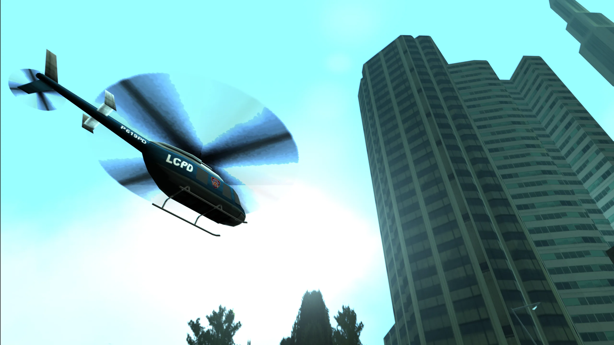
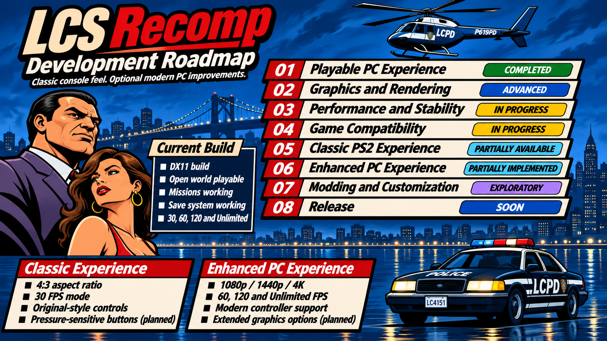

# LCS PS2 Recomp

  

<strong>Experimental PS2 to Windows recompilation project</strong>

Windows (x64) DirectX 11 · Work in progress (other platforms are planned)
 

## About

**LCS PS2 Recomp** is an independent project exploring native execution of the PlayStation 2 version of *Liberty City Stories* on Windows using recompilation and a custom runtime.

The aim is to make the game playable on PC while preserving the original experience. Optional improvements for modern hardware are also planned, but they should never replace the classic way to play.

This is an experimental project, **not a finished PC port or public game release**.

## AI-assisted development

Yes, AI is used extensively in this project - and I want to be transparent about that.

I work with Claude and a locally running Qwen 27B model to accelerate research, code exploration, implementation, debugging, profiling, and testing. At my current skill level, rebuilding and integrating the systems needed to run a complex console game on Windows could take many months, potentially much longer, without those tools. AI makes it possible to move much faster from a hypothesis to a working change and a real test.

Using AI does not mean the project builds itself or that technical knowledge is unnecessary. The work still requires understanding how the game and its original hardware behave: CPU execution and memory layouts, vector processors, synchronization, rendering commands, graphics pipelines, timing, controller inputs, audio, reverse engineering, and performance bottlenecks. It also requires recognizing incorrect assumptions, reading logs, reproducing bugs, comparing results, and preventing regressions.

AI-generated code can be wrong, inefficient, or incompatible with existing systems. I decide what belongs in the codebase, what gets rewritten or rejected, what trade-offs are acceptable, and what the project should become. AI helps with the workload; engineering decisions, integration, validation, and responsibility remain mine.

## Current Status

**Playable internal build | Active development**

LCS Recomp has evolved far beyond a simple rendering demonstration. The game is now playable on Windows through a native DirectX 11 rendering path, with ongoing improvements to gameplay accuracy, performance, high-frame-rate compatibility and PC-specific features.

### Gameplay & Compatibility

- **Windows / DirectX 11:** Functional rendering and gameplay on PC.
- **Open World:** Exploration, driving and core gameplay interactions are functional.
- **Missions:** Missions can be started and completed in tested scenarios.
- **Mission Timing:** Frame-dependent mission timers and counters have been reworked to maintain consistent timing across different frame rates. Verified in tested scenarios, with broader validation ongoing.
- **Save System:** Saving game progress works. Further save/load testing is planned.
- **Vehicle Handling:** General driving is functional, but motorcycle handling still requires further refinements.
- **Performance:** Various rendering, stability and frame-pacing optimizations have been implemented.

### Graphics & Display

- **Frame Rate Options:** 30, 60, 120 and Uncapped FPS.
- **Resolution Support:** Original, 1080p, 1440p, 4K and other PC resolutions.
- **Widescreen Support:** 16:9 with improved HUD positioning.
- **Anti-Aliasing:** MSAA 2x, 4x and 8x, adjustable during gameplay.
- **Anisotropic Filtering:** Runtime configuration implemented, with further visual verification ongoing.
- **Visual Improvements:** Full-resolution trails, corrected HUD positioning and various rendering fixes.
- **Pause Menu:** Correct 4:3 presentation regardless of gameplay aspect ratio.
- **Debug Tools:** In-game diagnostics (F2) and free-camera functionality (F8) are available in development builds.

### Keyboard, Mouse & Controller Support

Keyboard and mouse controls have been implemented in an experimental development build, bringing LCS Recomp closer to the experience of a dedicated PC version.

- **Keyboard & Mouse:** Functional on-foot and vehicle controls, with further improvements ongoing.
- **Native Mouse Camera:** Functional on foot, including vertical movement and camera collision handling.
- **Automatic Input Detection:** Detects the most recently used input device.
- **Mouse Wheel Weapon Switching:** Implemented.
- **Controller Support:** Gamepad controls remain functional.
- **Reworked Pause Menu:** Separate controller and keyboard/mouse setup pages.
- **PC Display Settings:** Resolution, frame limiting, MSAA, anisotropic filtering and additional graphics options.
- **Control Configuration:** On-foot and vehicle key mappings can be viewed. Interactive rebinding is still planned.

### Known Issues & Limitations

While the game is playable, several systems still require additional work:

- **Open-World Animation Timing:** Some environmental animations and objects are still affected by higher frame rates, including animated billboards and exhaust smoke.
- **Wanted Level Indicators:** Wanted stars currently flash too quickly when the wanted level is cooling down.
- **Motorcycle Handling:** Bike physics and handling are not yet fully consistent with the intended behavior.
- **High-FPS Compatibility:** Additional testing and corrections are required for animations and gameplay behavior at higher frame rates.
- **Mouse Controls:** Native vehicle camera controls and complete mouse-based free aiming are still in development.
- **PC Menu:** Interactive key rebinding, persistent settings and mouse-driven menu navigation are not yet complete.

### Currently in Development

- Complete mouse-based free aiming, including crosshair behavior and aiming movement.
- Implement native mouse camera controls for vehicles.
- Add dynamic button prompts that automatically switch between **keyboard, PS2 and Xbox controller icons** based on the active input device.
- Enable customizable key bindings and persistent settings.
- Add mouse interaction to the pause menu.
- Fix remaining frame-rate-dependent open-world animations and visual effects.
- Further refine motorcycle physics and handling.
- Continue improving performance, stability and rendering accuracy.

---

**Development Notice:** Some features are currently available only in experimental builds. Not all functionality has been fully validated, and features may change during development.

**LCS Recomp is not yet available for public release.**

<h2>PC Features (Work in Progress)</h2>

LCS Recomp is being expanded with PC-focused features while preserving the original game's visual identity. An experimental development build introduces redesigned menus, keyboard and mouse controls, controller configuration and additional graphics settings.

The screenshots below showcase the ongoing transition toward a more complete native PC experience. Some options are still being implemented or refined.

  
  
  

  <a href="docs/FEATURES.md">View all PC feature screenshots</a>

## Gameplay Screenshots

A few screenshots captured from the current development build.

  
  
  

<a href="docs/GALLERY.md">View all screenshots</a>

Development is ongoing. The following milestones show what has already been achieved and what is planned for future updates.

  

Planned features may change depending on technical feasibility and development progress.

### What comes next

The immediate priorities are **gameplay correctness and performance**, rather than adding new features before the existing ones are reliable:

1. Check game speed, physics, animations and mission timing at 60, 120 and uncapped frame rates.
2. Improve frame pacing, responsiveness and performance in busy scenes.
3. Expand testing of missions, save/load behavior, cutscenes, audio and long sessions.
4. Resolve remaining rendering issues and improve controller compatibility.
5. Verify a clean, reproducible Windows build and review third-party dependencies before any release.

## Download & Installation

The first public beta of LCS Recomp (v0.2.0) is now available!

LCS Recomp is still in active development. This release is intended to gather feedback on performance, stability, hardware compatibility and general gameplay. Some features are incomplete, and bugs or crashes may occur.

The dedicated launcher handles ISO validation, automated game preparation, game configuration and savegame management. Future releases will also support updates directly through the launcher.

**For the best current gameplay experience, I recommend playing at 60 FPS with a controller using the Classic control scheme.**

- [Download the latest Public Beta](https://github.com/NicoWayne95/lcs-ps2-recomp/releases)
- [Release Notes, Known Issues & Installation Guide](https://github.com/NicoWayne95/lcs-ps2-recomp/releases)
- [Community Feedback & Discussions](https://github.com/NicoWayne95/lcs-ps2-recomp/discussions)
- [Report Bugs & Technical Issues](https://github.com/NicoWayne95/lcs-ps2-recomp/issues)

### Game Files

LCS Recomp does not include original game files or copyrighted game assets. You need your own legally obtained copy of GTA: Liberty City Stories for PlayStation 2 in ISO format.

Currently, only the USA / NTSC-U version (SLUS-21423) is supported. The game is prepared and recompiled locally on your PC through the launcher.

## Credits

### PS2Recomp

This project uses parts of **[PS2Recomp by ran-j](https://github.com/ran-j/PS2Recomp)**, an experimental PlayStation 2 static recompiler and runtime project. Thanks to its developers and contributors for the work that made this possible.

PS2Recomp is published under the **[GPL-3.0 license](https://github.com/ran-j/PS2Recomp/blob/main/LICENSE)**. Attribution alone does not satisfy all license obligations; before distributing source code or binaries, the incorporated components, modifications and required notices must be reviewed.

Additional third-party acknowledgements will be added once the codebase audit is complete.

## Legal notice

**LCS PS2 Recomp is an unofficial, independent fan development project.** It is not affiliated with, endorsed by or sponsored by the original game's rights holders or any console manufacturer.

No rights to the original game, its trademarks, characters or assets are claimed. The cover displayed here is unofficial concept artwork, not official packaging; any age-rating-style symbol visible in the illustration is **not an official rating for this project**. The artwork should be reviewed before public distribution.

The project does not grant permission to redistribute copyrighted game files. A license for original project contributions has not yet been selected; third-party components remain subject to their own licenses.
