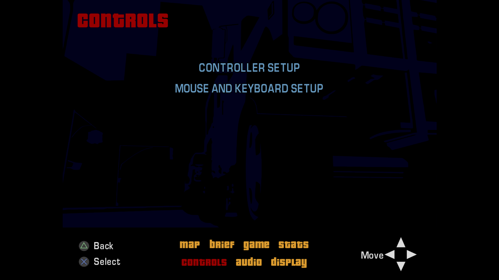
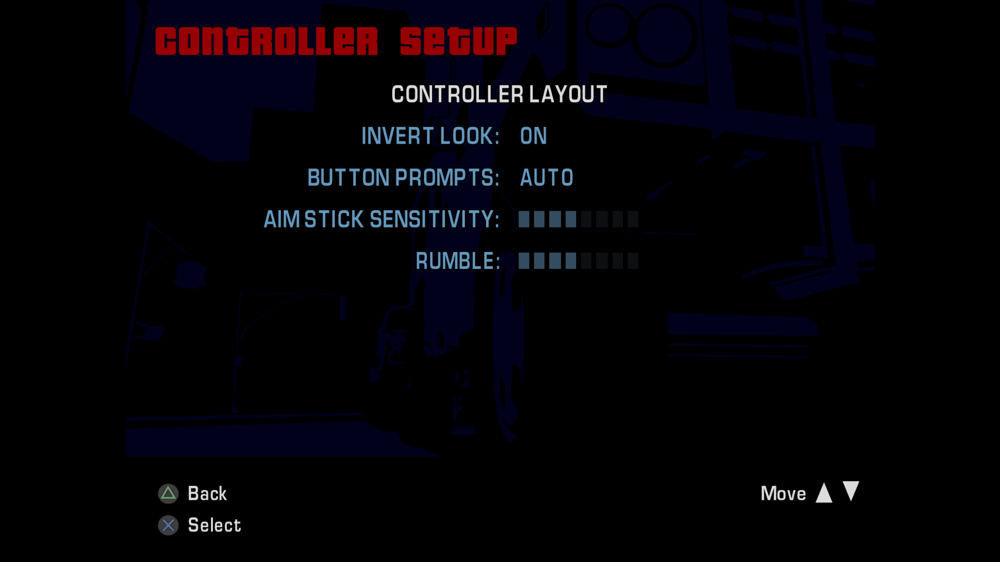
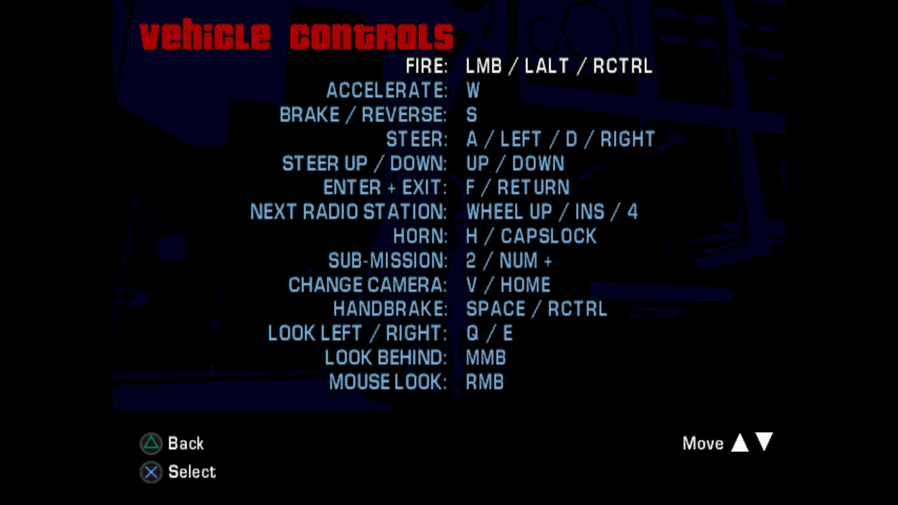
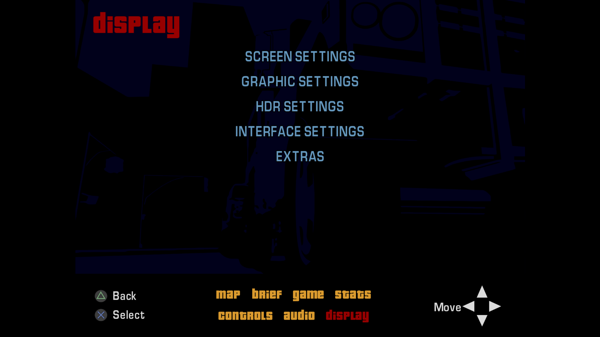
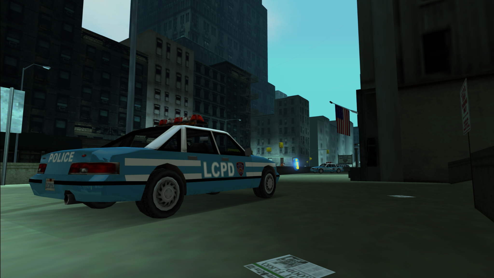
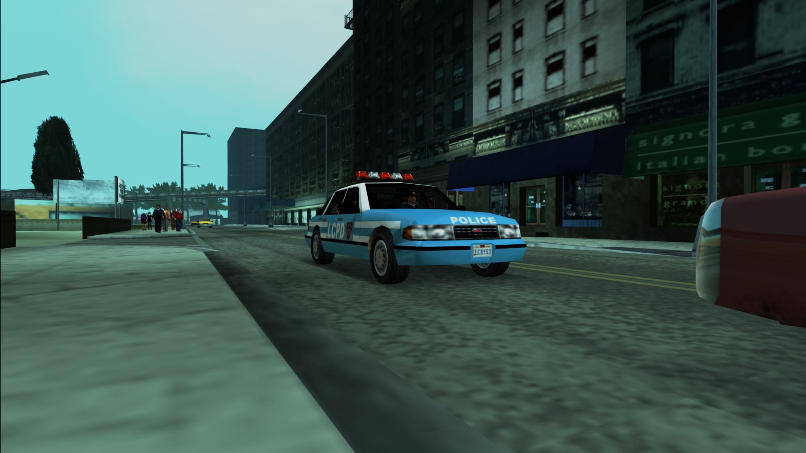
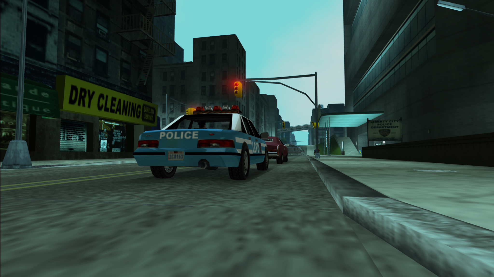

<h1 align="center">LCS Recomp — PC Features & Settings</h1>

  
  
  

  <a href="../README.md"><strong>Main Repository</strong></a> ·
  <a href="GALLERY.md">Gameplay Gallery</a> ·
  <a href="updates/README.md">Update History</a>

  <a href="#controls--input">Controls</a> ·
  <a href="#keyboard--mouse">Keyboard & Mouse</a> ·
  <a href="#screen-settings">Screen Settings</a> ·
  <a href="#graphics-settings">Graphics</a> ·
  <a href="#hdr-settings">HDR</a> ·
  <a href="#interface-settings">Interface</a> ·
  <a href="#extras">Extras</a>

## Overview

LCS Recomp expands the original PlayStation 2 interface with additional settings and configuration options designed specifically for modern PC hardware.

The goal is to preserve the original game's visual identity while providing greater flexibility over graphics, display configuration, controller input, keyboard and mouse controls, and optional enhancements.

Rather than replacing the original interface with an external configuration menu, these features are integrated into the game's existing menu structure.

> [!NOTE]
> **HD HUD Texture Pack**
>
> The screenshots on this page were captured with an optional HD HUD texture pack enabled.
>
> The sharper HUD elements, fonts, menu textures and controller button prompts may therefore differ from the original PlayStation 2 assets.
>
> HD texture packs are optional and are not included with LCS Recomp.

> [!IMPORTANT]
> These screenshots represent Windows development builds, including the v0.3.1 development version.
>
> Some features remain experimental and may change as development continues. The displayed settings are not necessarily the default or recommended configuration.

---

## Features at a Glance

| Category | Available Configuration |
| :--- | :--- |
| **Controller Input** | Controller layouts, button prompts, sensitivity and vibration |
| **Keyboard & Mouse** | Configurable bindings, mouse sensitivity and raw input |
| **Screen Settings** | Resolution scaling, monitor selection and display modes |
| **Frame Synchronization** | Frame limiter and variable refresh rate |
| **Graphics** | Draw distance, anti-aliasing and texture filtering |
| **Vehicle Reflections** | Configurable reflection filtering and resolution |
| **HDR Output** | Paper white, peak brightness, highlights and saturation |
| **Interface** | HUD visibility, HUD positioning, text size and subtitles |
| **Extras** | HD texture support and optional beta police car liveries |

---

## Controls & Input

The expanded controls menu provides separate configuration sections for controllers and keyboard and mouse input.

Players can configure their preferred input method while retaining the original game's controller experience.

  

### Controller Setup

The controller configuration menu includes:

- Controller layout selection.
- Inverted camera controls.
- Automatic button prompt selection.
- Adjustable aiming stick sensitivity.
- Adjustable controller vibration intensity.

  
  

  Controller configuration and vehicle control layout.

---

## Keyboard & Mouse

Native keyboard and mouse support provides an alternative to the original controller-based gameplay experience.

Available configuration options include:

- Adjustable mouse sensitivity.
- Inverted mouse input.
- Raw mouse input.
- Customizable keyboard bindings.
- Separate on-foot and vehicle controls.

  
  

### Customizable Keyboard Bindings

Separate configuration screens allow players to customize movement, combat, camera controls and vehicle-related actions.

  
  

  Keyboard and mouse configuration screenshots from an earlier development build.

---

## Display & Graphics

The display menu has been reorganized into dedicated categories, making the expanded PC configuration easier to navigate.

  

| Menu | Configuration |
| :--- | :--- |
| **Screen Settings** | Resolution, monitor, display mode and frame synchronization |
| **Graphic Settings** | Rendering quality and visual effects |
| **HDR Settings** | High dynamic range output configuration |
| **Interface Settings** | HUD layout, visibility and text scaling |
| **Extras** | Optional visual enhancements |

---

## Screen Settings

The screen configuration menu provides control over display output, internal rendering resolution and frame presentation.

  

### Configuration Options

| Setting | Description |
| :--- | :--- |
| **Screen Resolution** | Adjustable internal rendering resolution |
| **Monitor** | Select the preferred connected display |
| **Display Mode** | Configure the game's presentation mode |
| **Widescreen** | Enable or disable widescreen presentation |
| **Frame Sync** | Configure frame synchronization, including VRR |
| **Frame Limiter** | Configure the game's frame-rate target |
| **Brightness** | Adjust the game's brightness |
| **Restore Defaults** | Restore the default screen configuration |

  Example configuration: 5120 × 2880 internal resolution, VRR and a 180 FPS monitor-based frame limit.

> [!NOTE]
> Higher rendering resolutions and frame-rate targets increase hardware requirements. Actual performance depends on the CPU, GPU, selected settings and scene complexity.

---

## Graphics Settings

The graphics configuration menu provides additional control over rendering quality while preserving the original game's visual style.

  

### Configuration Options

| Setting | Description |
| :--- | :--- |
| **Draw Distance** | Adjust the visible rendering distance |
| **Anti-Aliasing** | Reduce visible aliasing through available anti-aliasing modes |
| **Texture Filtering** | Improve texture clarity at oblique viewing angles |
| **Car Reflections** | Configure vehicle reflection filtering |
| **Reflection Resolution** | Adjust vehicle reflection rendering resolution |
| **Trails** | Enable or disable the original trails effect |
| **Glow** | Enable or disable glow effects |
| **Restore Defaults** | Restore the default graphics configuration |

### Anti-Aliasing

LCS Recomp provides additional anti-aliasing options, including:

- SMAA.
- SMAA 2X.
- SMAA 4X.

These options allow players to balance image quality and rendering performance according to their hardware.

---

## HDR Settings

  
  

LCS Recomp supports configurable HDR output on compatible displays.

The dedicated HDR menu allows players to adjust the presentation according to their display capabilities and personal preferences.

  

### HDR Configuration

| Setting | Description |
| :--- | :--- |
| **HDR Output** | Enable or disable HDR presentation |
| **Paper White** | Adjust reference brightness in nits |
| **Peak Brightness** | Configure the target peak luminance |
| **Highlights** | Adjust highlight intensity |
| **Highlight Start** | Configure the threshold for highlight enhancement |
| **Saturation** | Adjust color saturation |
| **Restore Defaults** | Restore the default HDR configuration |

> [!IMPORTANT]
> The current HDR implementation represents the first stage of HDR support and is based on enhanced HDR output rather than a fully native HDR rendering pipeline.
>
> Native HDR rendering remains a long-term development goal.
>
> Enabling or disabling HDR output requires a game restart.

---

## Interface Settings

The interface configuration menu allows players to customize HUD presentation and text readability.

  

### Configuration Options

| Setting | Description |
| :--- | :--- |
| **Show HUD** | Enable or disable the gameplay HUD |
| **HUD Layout** | Configure HUD positioning |
| **Text Size** | Adjust supported in-game text elements |
| **Subtitles** | Enable or disable subtitles |
| **Restore Defaults** | Restore the default interface configuration |

### Adjustable Text Size

The text size configuration improves readability on modern displays and at higher resolutions.

Supported elements include:

- Subtitles.
- Mission messages.
- Help text.
- Area names.
- Vehicle names.
- Radio station names.

---

## Extras

The Extras menu provides optional enhancements that can be enabled or disabled independently.

The intention is to give players additional customization options without forcing changes to the original gameplay or visual experience.

  

### HD Texture Support

  
  

LCS Recomp supports compatible PCSX2 texture replacement packs.

This allows players to use optional high-resolution replacements for supported textures, including:

- HUD elements.
- Fonts and text textures.
- Controller button prompts.
- Radar and map textures.
- Icons.
- Loading screens.

Texture replacement can be enabled or disabled through the Extras menu.

> [!NOTE]
> Texture packs must be obtained separately. No third-party HD texture packs are distributed with LCS Recomp.

### Beta Police Cars

  
  

An optional visual enhancement inspired by the blue and white LCPD police car liveries associated with the game's early development appearance.

Players can enable or disable the alternative police appearance directly through the Extras menu.

  

  
  

  Optional blue and white LCPD police car appearance.

---

## Classic & Enhanced Experience

The long-term vision of LCS Recomp is to provide additional PC features without sacrificing the identity of the original PlayStation 2 release.

| Classic Experience | Enhanced PC Experience |
| :--- | :--- |
| Original controller layout | Configurable keyboard and mouse input |
| Original controller prompts | Adaptive controller prompts |
| Original rendering resolution | Higher internal rendering resolutions |
| Original frame-rate target | High-refresh-rate gameplay |
| Original textures | Optional HD texture replacements |
| Original visual effects | Additional graphics configuration |
| Original SDR presentation | Configurable HDR output |
| Original HUD presentation | Adjustable HUD layout and text size |
| Original police car appearance | Optional beta police car liveries |

These options are intended to coexist within the same game rather than requiring separate gameplay modes.

---

## Development Status

> [!WARNING]
> LCS Recomp is currently in Public Beta.
>
> Some settings and features may still be experimental, incomplete or subject to compatibility limitations.
>
> Screenshots may represent internal development versions and do not guarantee that every displayed feature is available in the latest public release.

LCS Recomp is a solo-developed project maintained in my spare time.

Community feedback, hardware testing and detailed bug reports are greatly appreciated.

  
  

---

  

  <a href="../README.md"><strong>Back to Main Repository</strong></a> ·
  <a href="GALLERY.md">Gameplay Gallery</a> ·
  <a href="updates/README.md">Update History</a>

  
    LCS Recomp is an unofficial, independent fan project. 
    Not affiliated with Rockstar Games or Take-Two Interactive.
  

