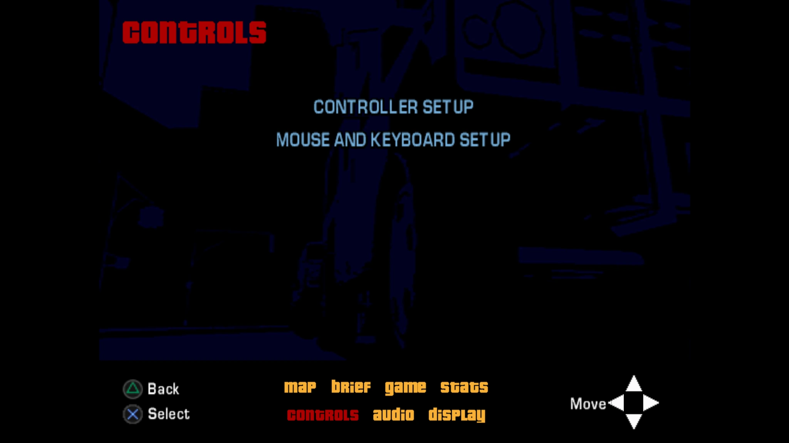
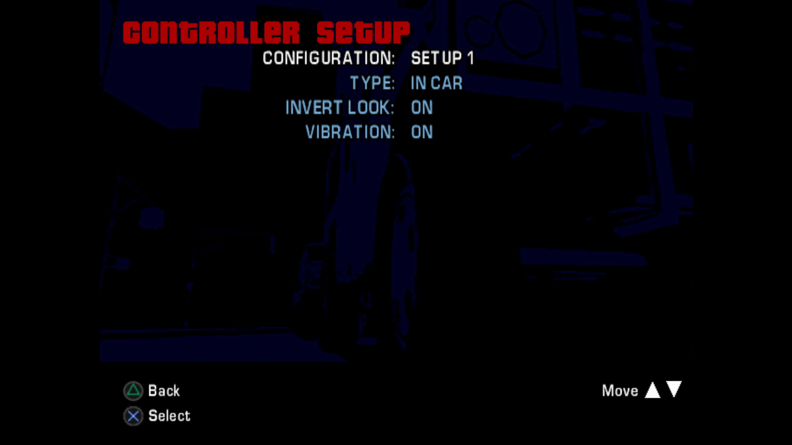
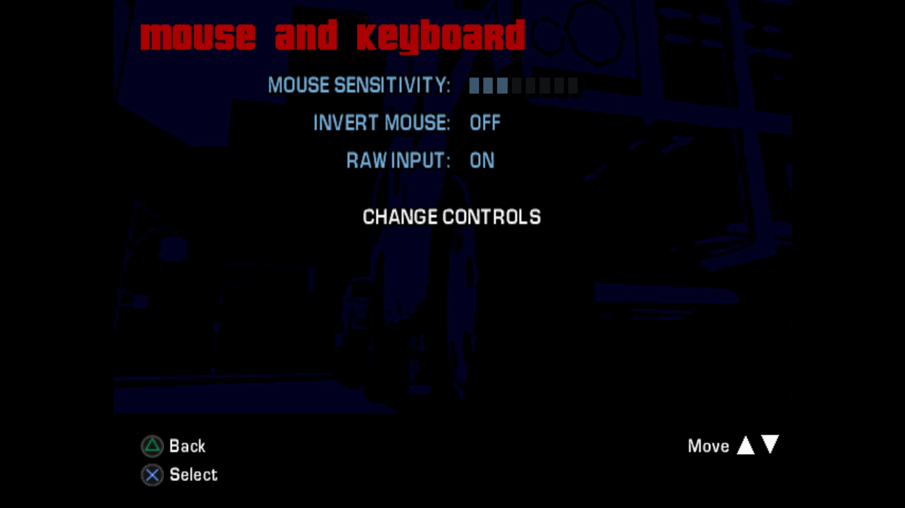
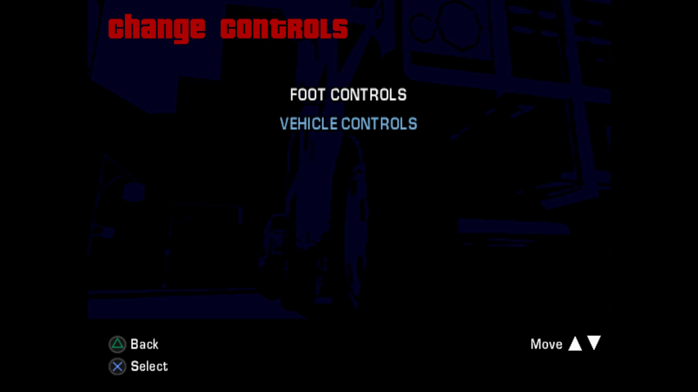
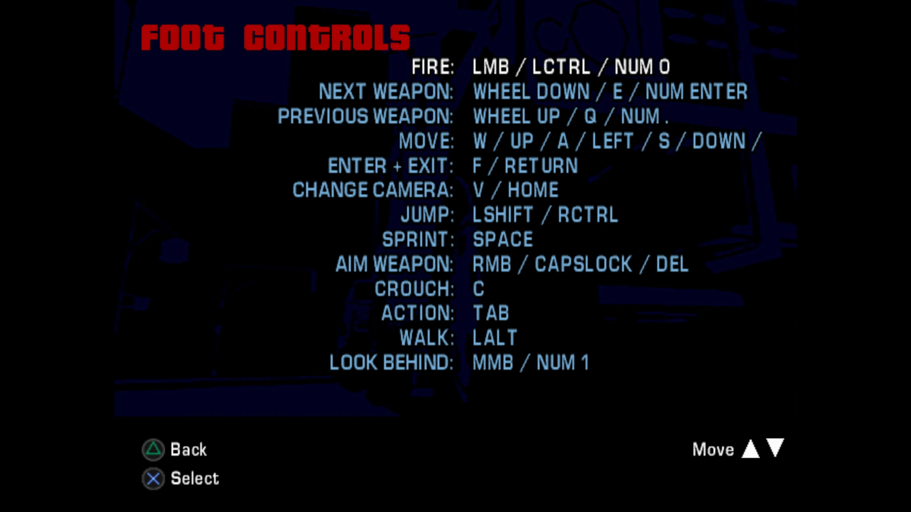
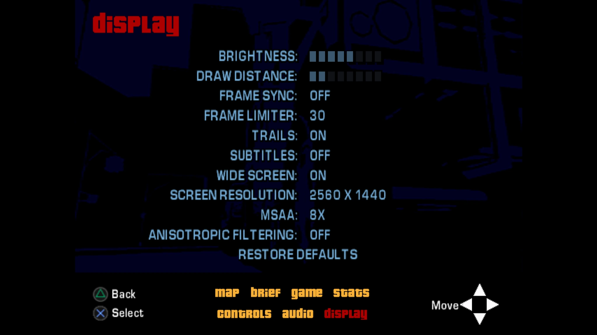

# LCS Recomp – PC Feature Showcase

A closer look at the PC-focused menus and settings currently being developed for **LCS PS2 Recomp**.

These screenshots were captured from an **internal Windows development build**. The interface, available options and their behavior may change as development continues.

[Back to README](../README.md) · [Gameplay Screenshot Gallery](GALLERY.md)

## Controls & Input

The controls menu is being expanded to support both the classic controller experience and configurable keyboard and mouse input.

  
  

  
  

## Customizable Keyboard Bindings

Separate configuration screens for movement on foot and driving. The screenshots show the current bindings displayed by the game, including keyboard and mouse assignments.

  
  

## Display & Graphics Settings

The PC display menu includes resolution selection and graphics-related options such as MSAA, anisotropic filtering, draw distance and frame synchronization. The values shown are from the captured development build, not finalized defaults or a guarantee that every option is fully implemented.

  

---

**Work in progress:** These screenshots are intended to document features being developed and may not represent their final appearance or functionality.

[Back to README](../README.md)
