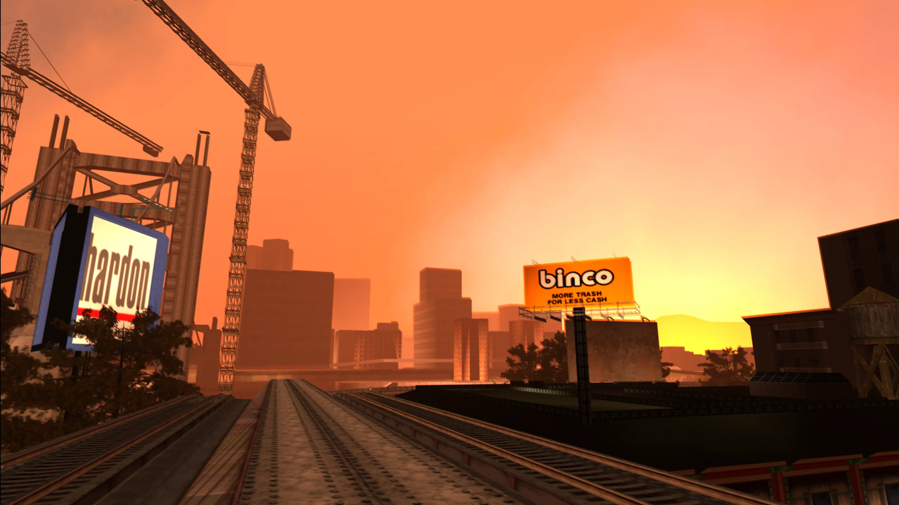
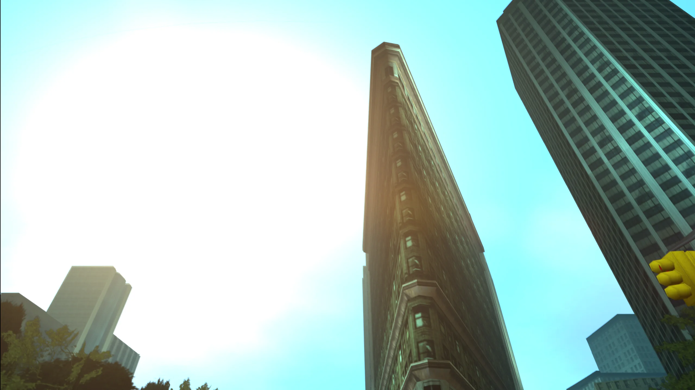
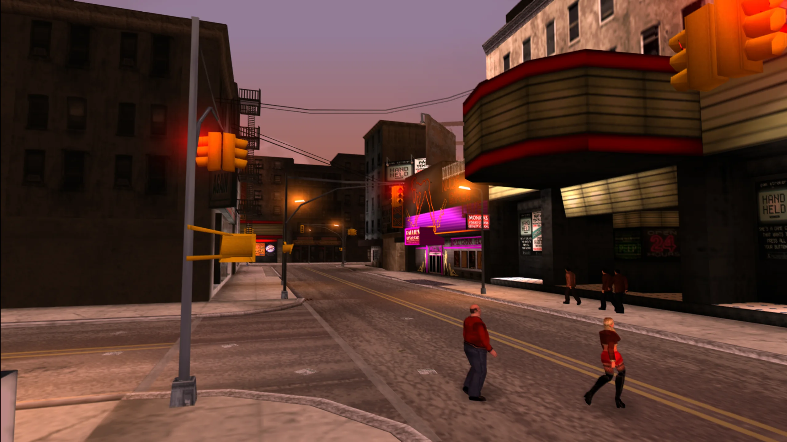
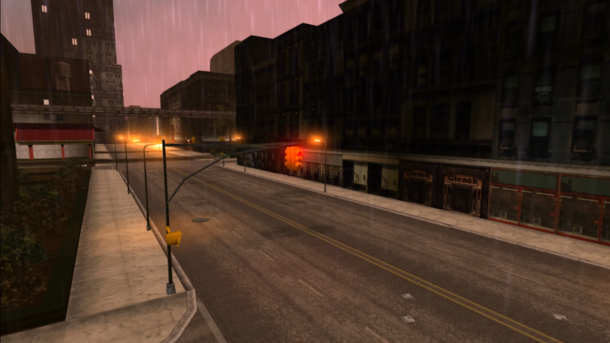
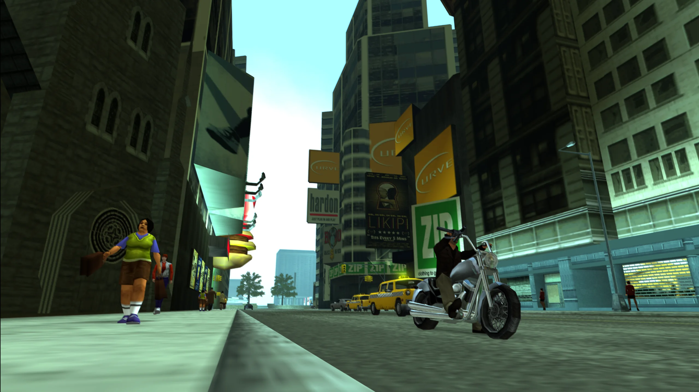
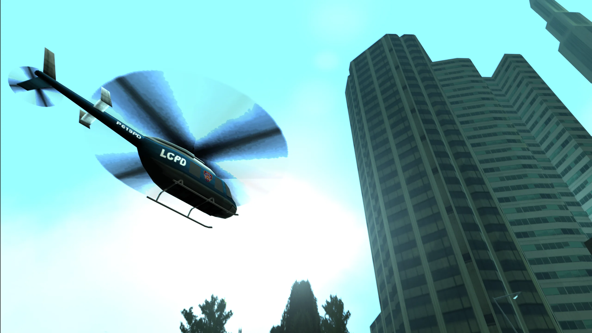
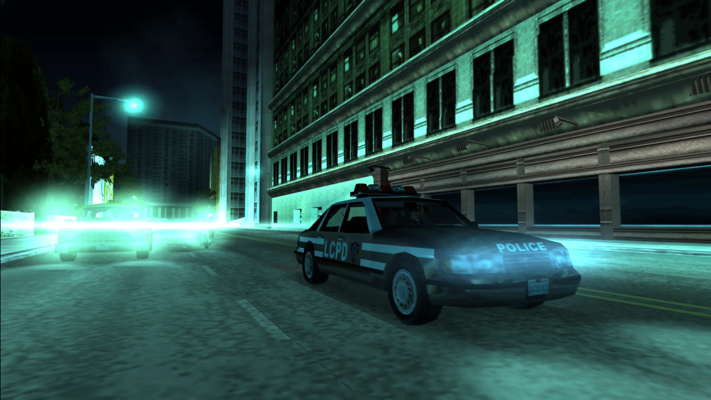

# LCS Recomp Screenshot Gallery

Screenshots captured from the current Windows development build. All images are 2560 × 1440. Rendering and visuals are still being improved.

[Back to the project README](../README.md)

## Liberty City & Atmosphere

  
  

  
  

## Transit & Vehicles

  
  

## Police & Helicopters

  
  

  

---

These images show an experimental development build and do not represent a finished release.

[Back to README](../README.md)
