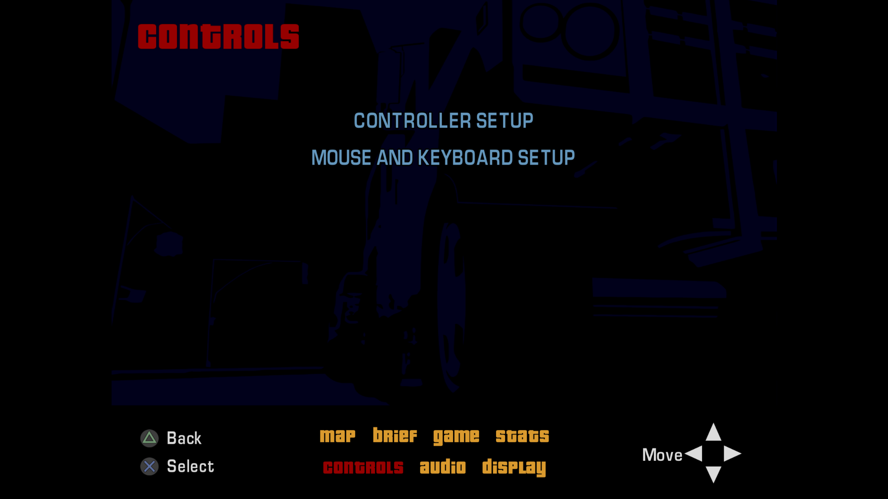
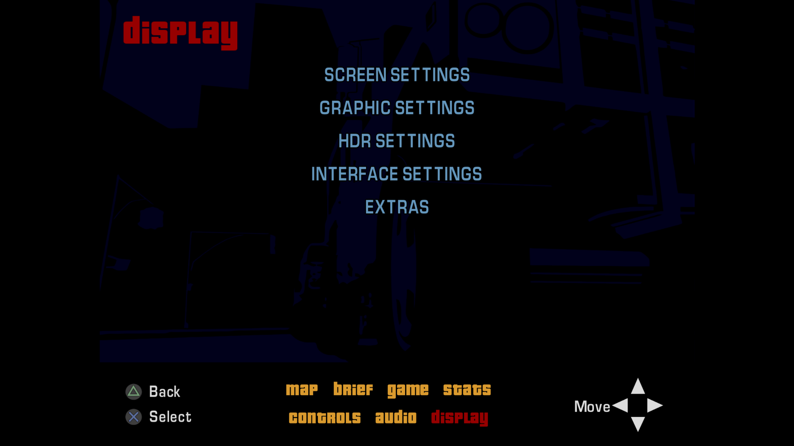
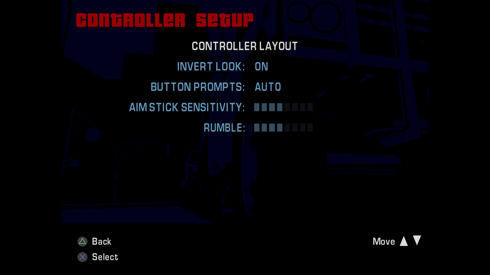
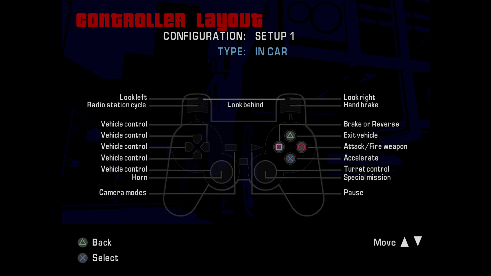
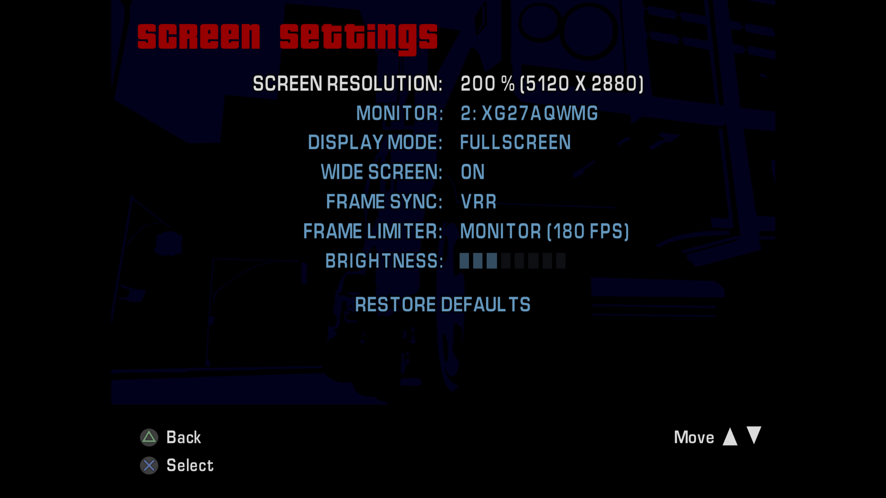
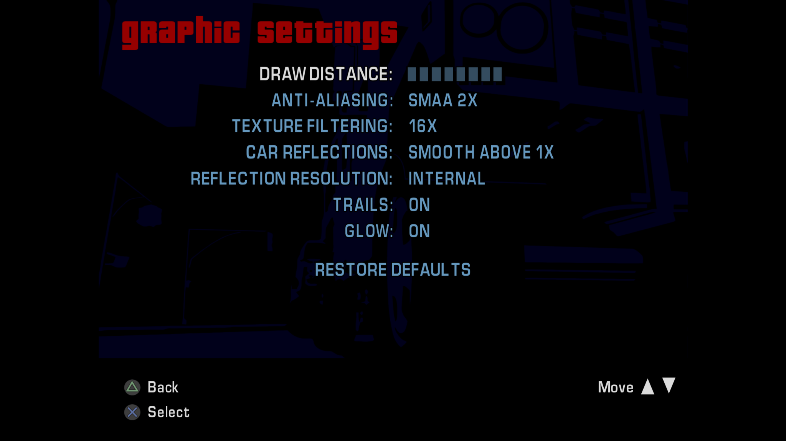
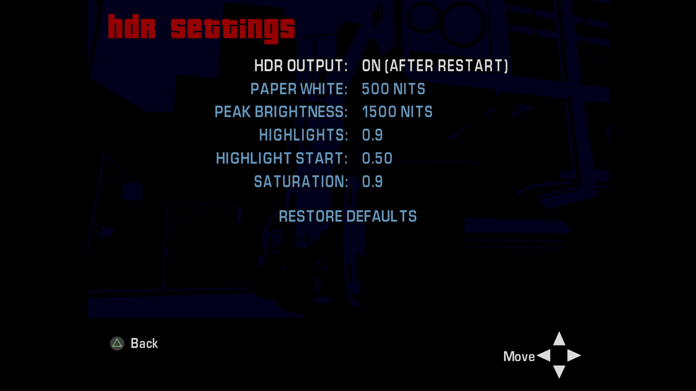
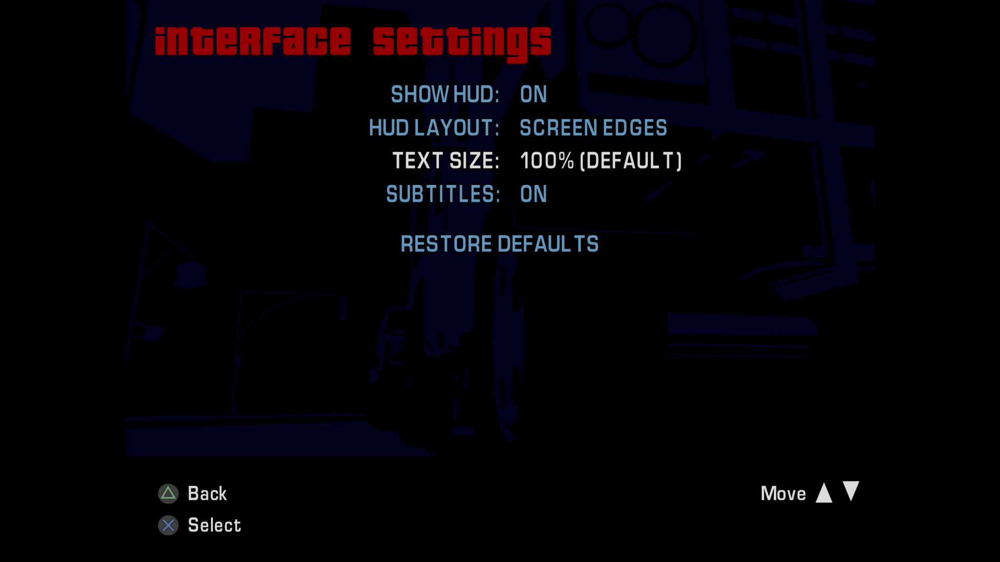
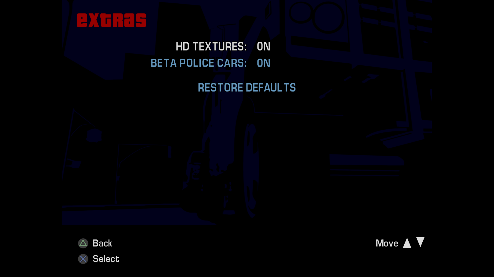
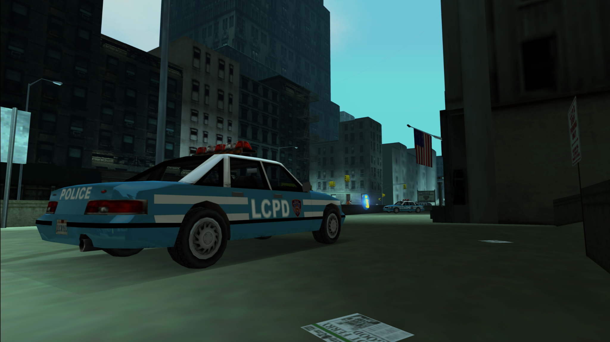

<h1 align="center">LCS Recomp v0.3.1</h1>

<h3 align="center">PC Interface & Gameplay Refinement Update</h3>

<p align="center">
  Redesigned in-game configuration menus, improved PC integration,<br>
  optional visual enhancements and further gameplay refinements.
</p>

<p align="center">
  
  
  
</p>

<p align="center">
  <a href="../../../README.md"><strong>Main Repository</strong></a> ·
  <a href="../README.md">Update History</a> ·
  <a href="../../FEATURES.md">PC Features</a> ·
  <a href="../../GALLERY.md">Screenshot Gallery</a>
</p>

<p align="center">
  <a href="#highlights">Highlights</a> ·
  <a href="#interface-overhaul">Interface Overhaul</a> ·
  <a href="#new-features">New Features</a> ·
  <a href="#gameplay--bug-fixes">Gameplay & Bug Fixes</a>
</p>

<p align="center">
  <a href="#performance--memory-management">Performance</a> ·
  <a href="#development-status">Development Status</a> ·
  <a href="#future-development">Future Development</a>
</p>

---

## Overview

**LCS Recomp v0.3.1** continues the development of the native PC recompilation of Grand Theft Auto: Liberty City Stories.

Following the major performance and rendering improvements introduced in v0.3.0, this update focuses on refining the PC experience, improving the accessibility of existing settings, introducing additional customization options and addressing gameplay issues reported by the community.

A major part of this update is the reorganization of the original in-game menus, integrating PC-specific configuration options directly into the game's existing interface while preserving its original visual identity.

Performance, stability and compatibility remain the primary long-term development priorities.

> [!IMPORTANT]
> This page represents an active development preview, not a finalized release.
>
> Features, settings and implementation details may change before publication.
>
> Implemented features are not necessarily fully tested or release-ready.

> [!NOTE]
> All screenshots on this page were captured with an optional **HD HUD texture pack** enabled.
>
> The higher-resolution fonts, menu textures, HUD elements and button prompts may differ from the original game's default assets.
>
> HD texture packs are optional and are not included with LCS Recomp.

---

## Highlights

<table>
  <tr>
    <td align="center" width="33%">
      <h3>Redesigned Menus</h3>
      Dedicated configuration categories integrated into the original interface.
    </td>
    <td align="center" width="33%">
      <h3>180 FPS</h3>
      Fixed maximum gameplay frame rate.
    </td>
    <td align="center" width="33%">
      <h3>New Extras</h3>
      Optional visual enhancements and texture replacement controls.
    </td>
  </tr>
</table>

| Category | Development Highlights |
| :--- | :--- |
| **Interface** | Reorganized in-game configuration menus |
| **Display** | Manual monitor selection and internal resolution configuration |
| **Graphics** | Dedicated graphics settings and simplified anti-aliasing configuration |
| **HDR** | Dedicated HDR configuration menu |
| **Controller Input** | Improved accessibility of controller configuration |
| **HUD** | Dedicated interface settings |
| **Extras** | Optional beta-inspired police car appearance |
| **Frame Rate** | Fixed maximum gameplay frame rate of 180 FPS |
| **Gameplay** | Investigation of community-reported timing and input issues |
| **Performance** | Continued optimization and investigation of memory usage |

---

## Interface Overhaul

The original PlayStation 2 menu structure has been expanded to accommodate the growing number of PC-specific configuration options.

Previously, several settings were distributed across different configuration interfaces. The reorganized menus provide a more consistent and accessible structure.

The objective is to integrate additional PC functionality without replacing the original game's menu design.

### Menu Structure

```text
Controls
├── Controller Setup
│   └── Controller Layout
└── Mouse & Keyboard Setup

Display
├── Screen Settings
├── Graphic Settings
├── HDR Settings
├── Interface Settings
└── Extras
```

<p align="center">
  <a href="screenshots/menu-controls.png">
    
  </a>
  <a href="screenshots/menu-display.png">
    
  </a>
</p>

<p align="center">
  <sub>Reorganized Controls and Display menus.</sub>
</p>

---

### Controller Setup

The controller configuration menu provides direct access to supported controller settings.

<p align="center">
  <a href="screenshots/menu-controller-setup.png">
    
  </a>
  <a href="screenshots/menu-controller-layout.png">
    
  </a>
</p>

<p align="center">
  <sub>Controller configuration and control layout.</sub>
</p>

| Setting | Description |
| :--- | :--- |
| **Controller Configuration** | Selection of supported controller configurations |
| **Camera Inversion** | Adjustable inverted camera behavior |
| **Button Prompts** | Configuration of supported input-device-specific prompts |
| **Aim Stick Sensitivity** | Adjustable analog-stick aiming sensitivity |
| **Vibration** | Configuration of supported controller vibration |
| **Controller Layout** | Dedicated overview of the selected controller configuration |

Existing controller functionality from previous releases is retained and presented through the reorganized interface.

Controller compatibility and input behavior remain subject to further testing.

---

### Screen Settings

The dedicated Screen Settings menu separates display configuration from graphics quality and visual effects.

<p align="center">
  <a href="screenshots/menu-screen-settings.png">
    
  </a>
</p>

| Setting | Description |
| :--- | :--- |
| **Screen Resolution** | Configurable internal rendering resolution |
| **Monitor** | Manual selection of the preferred connected display |
| **Display Mode** | Configuration of supported presentation modes |
| **Widescreen** | Widescreen presentation configuration |
| **Frame Sync** | Frame synchronization configuration, including VRR |
| **Frame Limiter** | Selection of supported frame-rate targets |
| **Brightness** | Adjustable game brightness |
| **Restore Defaults** | Restores the default screen configuration |

Internal rendering resolution can be configured independently of the monitor's native resolution.

This allows the game to render above the physical display resolution where supported by the selected configuration.

> [!NOTE]
> Higher rendering resolutions increase GPU workload and memory requirements.
>
> Monitor refresh rate does not override the maximum supported gameplay frame rate of 180 FPS.

---

### Graphic Settings

Graphics-related options are now organized within a dedicated menu rather than being combined with general display settings.

<p align="center">
  <a href="screenshots/menu-graphics-settings.png">
    
  </a>
</p>

| Setting | Description |
| :--- | :--- |
| **Draw Distance** | Adjusts supported object detail distances |
| **Anti-Aliasing** | Selection of supported SMAA modes |
| **Texture Filtering** | Configurable anisotropic texture filtering |
| **Car Reflections** | Configuration of vehicle reflection filtering |
| **Reflection Resolution** | Adjustable vehicle reflection resolution |
| **Trails** | Toggle for the original visual trails effect |
| **Glow** | Configuration of glow effects |
| **Restore Defaults** | Restores the default graphics configuration |

#### Anti-Aliasing

The supported anti-aliasing modes are:

- SMAA
- SMAA 2X
- SMAA 4X

The previously available MSAA implementation has been removed.

SMAA remains the supported anti-aliasing solution and provides different image-quality and performance trade-offs.

#### Draw Distance

The current Draw Distance setting primarily affects supported object detail distances.

It does not yet provide a complete extension of world geometry streaming distance.

Further changes to the original streaming and LOD systems are required before significantly extended world draw distances can be supported reliably.

---

### HDR Settings

<p>
  
  
</p>

The HDR configuration introduced in v0.3.0 is now accessible through a dedicated in-game menu.

<p align="center">
  <a href="screenshots/menu-hdr-settings.png">
    
  </a>
</p>

| Setting | Description |
| :--- | :--- |
| **HDR Output** | Enables or disables HDR presentation |
| **Paper White** | Configurable reference brightness |
| **Peak Brightness** | Configurable target peak luminance |
| **Highlights** | Adjustable highlight intensity |
| **Highlight Start** | Configurable highlight enhancement threshold |
| **Saturation** | Adjustable color saturation |
| **Restore Defaults** | Restores the default HDR configuration |

> [!IMPORTANT]
> The current HDR implementation enhances the original game's SDR presentation for HDR-compatible displays.
>
> It is not a fully native HDR rendering pipeline.
>
> Native HDR rendering remains a long-term development goal.

HDR output requires a compatible display and Windows HDR support.

The dedicated menu improves accessibility of the existing HDR functionality rather than introducing a new native HDR renderer.

---

### Interface Settings

HUD-related options and interface customization are now organized within a dedicated menu.

<p align="center">
  <a href="screenshots/menu-interface-settings.png">
    
  </a>
</p>

| Setting | Description |
| :--- | :--- |
| **Show HUD** | Enables or disables gameplay HUD elements |
| **HUD Layout** | Configuration of supported HUD positioning |
| **Text Size** | Adjustable size of supported text elements |
| **Subtitles** | Enables or disables subtitles |
| **Restore Defaults** | Restores the default interface configuration |

Adjustable text scaling was introduced in v0.3.0 and is now integrated into the reorganized interface.

Supported text elements include:

- Subtitles.
- Mission messages.
- Help text.
- Area names.
- Vehicle names.
- Radio station names.

Not every HUD element necessarily uses the same scaling behavior.

---

### Extras

The new Extras menu provides a dedicated location for optional enhancements that are not required for the original gameplay experience.

<p align="center">
  <a href="screenshots/menu-extras.png">
    
  </a>
</p>

| Option | Description |
| :--- | :--- |
| **HD Textures** | Configuration of optional texture replacement support |
| **Beta Police Cars** | Optional blue and white LCPD police car appearance |

The Extras menu also provides a foundation for organizing additional optional enhancements in future updates.

---

## New Features

### Blue Beta Police Cars

<p>
  
  
</p>

An optional blue and white police car appearance inspired by the early development appearance of Liberty City Stories has been implemented in the current development build.

The alternative appearance is accessible through the Extras menu, allowing players to choose between the original black and white police car appearance and the optional beta-inspired version.

<p align="center">
  <a href="screenshots/beta-police-car-side.png">
    
  </a>
</p>

<p align="center">
  <sub>Optional beta-inspired LCPD police car appearance.</sub>
</p>

#### Technical Background

Simply changing the vehicle color values in `carcols.dat` was insufficient to change the visible police car body.

During earlier development tests:

- Updated vehicle color values were recognized.
- Collision-related paint particles appeared blue.
- The visible vehicle body remained black and white.

This demonstrated that the remaining issue involved the vehicle's material and color application rather than only its configured color values.

The current development build successfully displays the alternative blue and white appearance.

Further validation is required across relevant vehicle rendering and damage states.

> [!NOTE]
> This is an optional visual enhancement inspired by the game's early development appearance.
>
> It is not intended to replace the original retail appearance by default.

---

### Manual Monitor Selection

Players can select their preferred connected monitor directly through the Screen Settings menu.

This improves display configuration on multi-monitor systems and complements the automatic display detection introduced in earlier versions.

The objective is to provide more control over the selected display without requiring changes to the operating system's primary monitor configuration.

---

### Revised Frame-Rate Limiter

The frame-rate configuration has been revised to provide a more controlled gameplay environment.

The current development build enforces a **fixed maximum gameplay frame rate of 180 FPS**.

| Frame-Rate Configuration | Current Development Behavior |
| :--- | :--- |
| Lower frame-rate targets | Supported through the available frame limiter |
| Monitor-based selection | Limited to the supported maximum |
| Maximum frame rate | 180 FPS |
| Unlimited frame rate | No longer part of the normal gameplay configuration |

The previous unrestricted frame-rate behavior is no longer available as a normal gameplay option.

This change helps limit extreme frame-rate conditions that can interfere with the original game's timing, simulation and animation systems.

> [!NOTE]
> Historical development benchmarks exceeding 180 FPS remain valid as measurements of rendering throughput.
>
> They do not represent the maximum gameplay frame rate of v0.3.1.

---

## Gameplay & Bug Fixes

Development of v0.3.1 includes investigation of several gameplay and rendering issues identified during previous testing and community feedback.

The following sections distinguish visually confirmed fixes from issues that still require investigation or regression testing.

### Confirmed Visual Fixes

| Issue | Improvement | Status |
| :--- | :--- | :--- |
| **Police Car Recoloring** | Alternative blue and white vehicle appearance is now rendered visibly | Visually confirmed |

Additional testing remains necessary to validate the alternative vehicle appearance across relevant gameplay and rendering conditions.

### Gameplay Issues Under Investigation

| Issue | Description | Status |
| :--- | :--- | :--- |
| **Aspect Ratio & UI Scaling** | Inconsistent text or interface presentation between 4:3 and 16:9 configurations | Requires validation |
| **Pay 'n' Spray Effects** | Spray particles disappear prematurely instead of remaining visible for their intended lifetime | Requires validation |
| **Health Indicator Flashing** | Incorrect flashing behavior of the health indicator | Requires validation |
| **Mouse Aiming Accuracy** | Projectiles do not consistently align with the displayed crosshair when using mouse input | Investigating |
| **Rollercoaster Scare** | Incorrect behavior of the scare system or indicator during the rollercoaster sequence | Requires validation |
| **Taxi Mission Timer** | Potentially incorrect timer behavior at elevated frame rates | Requires validation |
| **Police Siren Behavior** | Incorrect siren behavior reported above the original 30 FPS target | Requires validation |
| **Vehicle Damage & Fire** | Potential frame-rate-dependent vehicle damage or fire behavior | Unconfirmed |

These issues must not be considered fixed until their behavior has been reproduced, corrected and validated.

<details>
<summary><strong>View Detailed Gameplay Investigations</strong></summary>

### Aspect Ratio & Interface Scaling

Certain interface elements may behave inconsistently between different aspect ratios and rendering configurations.

Testing includes:

- Original 4:3 presentation.
- 16:9 widescreen presentation.
- Different internal rendering resolutions.
- Text scaling and HUD positioning.
- Consistent interface alignment.

### Pay 'n' Spray Particle Effects

The spray effect inside Pay 'n' Spray may disappear almost immediately after being generated.

The investigation focuses on:

- Particle lifetime.
- Particle update behavior.
- Effect initialization and cleanup.
- Potential dependencies on frame rate.
- Consistency with the original PlayStation 2 behavior.

### Health Indicator Flashing

The flashing behavior of the health indicator requires further validation.

Testing should determine whether the animation timing remains consistent across supported frame-rate targets.

### Mouse Aiming & Projectile Accuracy

Comparative testing has identified inconsistent aiming behavior between controller and mouse input.

With controller input, projectiles aligned correctly with the crosshair in the tested scenarios.

With mouse input, projectiles could deviate from the displayed crosshair depending on the distance to the target.

The issue has been narrowed down to the mouse-aiming implementation.

Further investigation focuses on:

- Camera orientation.
- Crosshair projection.
- Weapon aiming direction.
- Projectile alignment.
- Synchronization between mouse input and the original aiming system.

Related issue: [GitHub Issue #25](https://github.com/NicoWayne95/lcs-ps2-recomp/issues/25)

### Rollercoaster Scare

The rollercoaster scare system requires additional compatibility testing.

Potential dependencies on the original simulation timing must be investigated before determining the required correction.

### Taxi Mission Timer

Mission timer behavior requires validation across different frame-rate targets.

The objective is to preserve the intended real-time behavior of the original taxi missions.

### Police Siren Behavior

Incorrect siren behavior has been reported when running the game above 30 FPS.

Further investigation is required to determine whether the issue originates from audio timing, vehicle state updates or another frame-dependent system.

### Vehicle Damage & Fire

Potential frame-rate-dependent vehicle damage and fire behavior requires further reproduction and comparison with the original PlayStation 2 version.

The existence and exact cause of the issue have not yet been conclusively established.

</details>

---

## Performance & Memory Management

<p>
  
  
</p>

Performance optimization remains one of the primary development priorities of LCS Recomp.

Version 0.3.0 introduced substantial improvements to native rendering, CPU efficiency, frame presentation, resource reuse and world streaming.

Development following v0.3.0 continues to focus on identifying remaining bottlenecks and improving efficiency across different hardware configurations.

### Current Optimization Priorities

| Area | Development Objective |
| :--- | :--- |
| **CPU Efficiency** | Reduce remaining CPU-side rendering and runtime overhead |
| **Native Rendering** | Expand and optimize validated native rendering paths |
| **GS Processing** | Reduce unnecessary PlayStation 2 Graphics Synthesizer processing |
| **GPU Resources** | Improve resource reuse and reduce unnecessary processing |
| **Frame Pacing** | Improve frame-time consistency |
| **World Streaming** | Reduce loading-related stalls and unnecessary resource preparation |
| **Hardware Compatibility** | Improve performance on older and lower-end hardware |
| **Long-Session Stability** | Investigate stability during extended gameplay sessions |

> [!NOTE]
> No additional v0.3.1 performance improvements are being quantified at this stage.
>
> New performance claims will be based on reproducible benchmark results rather than estimated gains.

### Memory Usage

Community reports have identified increasing system memory usage during extended gameplay sessions.

Memory management has not yet received a dedicated comprehensive optimization pass.

Further investigation is planned to distinguish expected cache growth from unnecessary resource retention and potential memory leaks.

The investigation will cover:

- System RAM usage.
- Video memory usage.
- Texture caches.
- Geometry and mesh caches.
- Direct3D 11 resource lifetime management.
- World streaming resources.
- Native runtime allocations.
- Resource allocation and cleanup behavior.
- Long-session memory growth.

Increasing memory usage alone does not establish the existence of a memory leak.

Persistent caches may account for part of the observed increase, and profiling is required before identifying the underlying cause.

Related issue: [GitHub Issue #29](https://github.com/NicoWayne95/lcs-ps2-recomp/issues/29)

---

## Removed & Revised Functionality

Several existing features and configuration behaviors have been revised as development continues.

| Previous Functionality | v0.3.1 Development Behavior |
| :--- | :--- |
| MSAA anti-aliasing | Removed |
| Unrestricted gameplay frame rates | Replaced by a maximum of 180 FPS |
| Combined display configuration | Reorganized into dedicated categories |
| Previously distributed PC settings | Consolidated into the expanded in-game menu structure |
| Existing HDR configuration | Accessible through a dedicated HDR menu |
| Existing HUD configuration | Accessible through a dedicated Interface Settings menu |

The reorganization of existing settings should not be interpreted as the introduction of entirely new underlying rendering or input systems.

---

## Development Status

The following overview summarizes the current development state.

| Feature or Development Area | Status |
| :--- | :--- |
| Reorganized in-game menu structure | Implemented in development build |
| Controller Setup | Available in development build |
| Controller Layout | Available in development build |
| Screen Settings | Available in development build |
| Graphic Settings | Available in development build |
| HDR Settings | Available in development build |
| Interface Settings | Available in development build |
| Extras menu | Available in development build |
| Manual monitor selection | Available in development build |
| Maximum frame rate of 180 FPS | Implemented |
| MSAA removal | Completed |
| Blue beta police car appearance | Visually confirmed |
| Mouse aiming accuracy | Investigating |
| Additional gameplay fixes | Validation pending |
| Dedicated memory-management optimization | Planned |
| Further performance optimization | Ongoing |
| Launcher redesign | Planned |

### Status Definitions

| Status | Meaning |
| :--- | :--- |
| **Implemented** | The change is present in the current development build |
| **Visually Confirmed** | The expected visual result has been demonstrated |
| **Validation Pending** | Further reproduction or regression testing is required |
| **Investigating** | The cause or required implementation is being examined |
| **Ongoing** | Development and optimization continue |
| **Planned** | A development objective without a confirmed release commitment |

> [!IMPORTANT]
> Implementation does not automatically mean that a feature has been fully validated across all supported hardware configurations and gameplay scenarios.

---

## Future Development

Development beyond the current preview will continue to focus on performance, compatibility, stability and preserving the original Liberty City Stories experience.

The following objectives are part of the broader project roadmap and are not guaranteed to be included in v0.3.1.

### Launcher Redesign

<p>
  
  
</p>

A complete redesign of the current launcher is planned.

The existing launcher was initially developed to provide a functional game preparation and distribution workflow.

The next-generation launcher is intended to provide a more maintainable and efficient long-term foundation.

Development objectives include:

- Redesigned launcher architecture.
- Improved user interface and usability.
- Faster game preparation.
- Reduced compilation and build times.
- Improved dependency management.
- More transparent build progress.
- Improved download and verification workflows.
- More reliable update handling.
- Improved error reporting and recovery.
- Better separation between launcher and game runtime.
- Windows, Linux and macOS launcher compatibility.

Improvements to the existing launcher may continue while its replacement is being developed.

> [!NOTE]
> Cross-platform launcher compatibility does not automatically provide native game runtime compatibility on Linux or macOS.
>
> Additional runtime platforms require separate implementation and validation.

Related issue: [GitHub Issue #28](https://github.com/NicoWayne95/lcs-ps2-recomp/issues/28)

---

### Long-Term Rendering & Graphics

| Feature | Development Objective |
| :--- | :--- |
| **Native HDR Rendering** | Development of a fully native HDR rendering pipeline |
| **Extended World Draw Distance** | Improvements to world streaming, LOD handling and visibility |
| **Native Rendering** | Further replacement of unnecessary PS2-specific processing |
| **Vehicle Rendering** | Improved rendering accuracy and efficiency |
| **HD Textures** | Expanded replacement-texture compatibility |
| **Performance** | Further CPU and GPU optimization |

### Gameplay & Compatibility

| Feature | Development Objective |
| :--- | :--- |
| **Mouse Aiming** | Improved crosshair and projectile accuracy |
| **Vehicle Camera** | Further camera behavior refinements |
| **Motorcycle Controls** | Improved handling and input behavior |
| **Controller Compatibility** | Additional device support and testing |
| **High-FPS Gameplay** | Further timing and simulation validation |
| **Regional Game Versions** | Investigation of additional regional PS2 release compatibility |
| **Mission Compatibility** | Expanded gameplay and cutscene testing |

### Modding & Development Tools

Additional modding functionality is planned where technically feasible.

Potential development areas include:

- Mod-loader support.
- Improved asset inspection.
- Texture customization.
- Vehicle customization.
- World and map inspection tools.
- Optional in-game trainer functionality.
- Improved runtime diagnostics.
- Additional development and debugging tools.

These features remain subject to technical feasibility and available development time.

### Additional Platforms

The possibility of supporting additional game runtime platforms remains a long-term development objective.

Potential areas of investigation include:

- Linux runtime compatibility.
- macOS runtime compatibility.
- Additional graphics backends where technically feasible.
- Improved cross-platform build tooling.

No release dates or platform commitments are currently being announced.

---

## PC Feature Showcase

The full PC Feature Showcase provides additional screenshots and descriptions of the expanded configuration interface.

<table>
  <tr>
    <td align="center" width="50%">
      <a href="../../FEATURES.md">
        <strong>PC Features & Settings</strong>
      </a>
      <br><br>
      Controller configuration, screen settings, graphics, HDR, interface customization and optional enhancements.
    </td>
    <td align="center" width="50%">
      <a href="../../GALLERY.md">
        <strong>Gameplay Screenshot Gallery</strong>
      </a>
      <br><br>
      Explore Liberty City, its vehicles, atmosphere and visual presentation.
    </td>
  </tr>
</table>

<p align="center">
  <a href="../../FEATURES.md">
    
  </a>
  <a href="../../GALLERY.md">
    
  </a>
</p>

---

## Availability

<p>
  
  
</p>

Version 0.3.1 is currently being developed and tested.

The screenshots and information on this page document the development build rather than a finalized public release.

The final feature set will depend on implementation progress, regression testing and release readiness.

No specific release date is being announced at this stage.

For available public builds, please refer to GitHub Releases.

<p align="center">
  <a href="https://github.com/NicoWayne95/lcs-ps2-recomp/releases/latest">
    
  </a>
</p>

---

## Community & Feedback

Community feedback continues to play an important role in identifying gameplay issues, performance limitations and hardware-specific compatibility problems.

When reporting an issue, please include:

| Information | Details |
| :--- | :--- |
| **Game Version** | Installed LCS Recomp version |
| **CPU** | Processor model |
| **GPU** | Graphics card model |
| **RAM** | Installed system memory |
| **Operating System** | Windows version |
| **Resolution** | Display and internal rendering resolution |
| **Frame Rate** | Selected frame-rate target |
| **Graphics Settings** | Relevant rendering configuration |
| **HD Textures** | Enabled or disabled |
| **HDR** | Enabled or disabled |
| **Issue Description** | Description of the observed behavior |
| **Reproduction Steps** | Steps required to reproduce the issue |

Screenshots, recordings, runtime logs, frame-time captures and comparisons with the original PlayStation 2 version are particularly useful.

<p align="center">
  <a href="https://github.com/NicoWayne95/lcs-ps2-recomp/issues">
    
  </a>
  <a href="https://github.com/NicoWayne95/lcs-ps2-recomp/discussions">
    
  </a>
</p>

---

## Credits

LCS Recomp builds upon the work of existing open-source projects and their contributors.

| Project | Contribution | License |
| :--- | :--- | :--- |
| [PS2Recomp — ran-j](https://github.com/ran-j/PS2Recomp) | Static PlayStation 2 recompilation and foundational runtime | GPL-3.0 |
| [GTA: Vice City Stories Recomp — gothamor](https://github.com/gothamor/gta-vcs-recomp) | Technical foundation and derived native runtime components | GPL-3.0 |
| [HCTP Recomp — BigDaddyJRich](https://github.com/BigDaddyJRich/hctp-recomp) | VU1 recompilation foundation | GPL-3.0 |
| [Kenney Input Prompts](https://kenney.nl/assets/input-prompts) | Adaptive controller, keyboard and mouse icon assets | CC0 1.0 |

Additional attribution and licensing information can be found in the project's `NOTICE.txt` and associated license files.

HD HUD texture packs remain the work of their respective creators and are not included with LCS Recomp.

Thank you to everyone who has tested previous releases, reported issues, shared performance results and provided constructive feedback.

---

## Continue Exploring

| Resource | Description |
| :--- | :--- |
| [Main Repository](../../../README.md) | Project overview and current development status |
| [Update History](../README.md) | Previous releases and development previews |
| [v0.3.0 Update](../v0.3.0/README.md) | Previous performance and quality-of-life update |
| [PC Feature Showcase](../../FEATURES.md) | Expanded menus and PC configuration |
| [Screenshot Gallery](../../GALLERY.md) | Gameplay screenshots from Liberty City |
| [Repository Activity](https://github.com/NicoWayne95/lcs-ps2-recomp/commits/main/) | Recent public repository changes |
| [GitHub Releases](https://github.com/NicoWayne95/lcs-ps2-recomp/releases) | Available public releases |

---

<p align="center">
  <strong>Liberty City Stories. Recompiled for PC.</strong>
</p>

<p align="center">
  Developed independently, in my spare time,<br>
  with the goal of preserving and enhancing the original experience.
</p>

<p align="center">
  <sub>
    LCS Recomp is an unofficial, independent fan project.<br>
    Not affiliated with Rockstar Games or Take-Two Interactive.
  </sub>
</p>

<p align="center">
  <a href="../../../README.md">Main Repository</a> ·
  <a href="../README.md">Update History</a> ·
  <a href="https://github.com/NicoWayne95/lcs-ps2-recomp/releases/latest">Latest Public Release</a>
</p>

<p align="center">
  <strong>See you in Liberty City!</strong>
</p>
